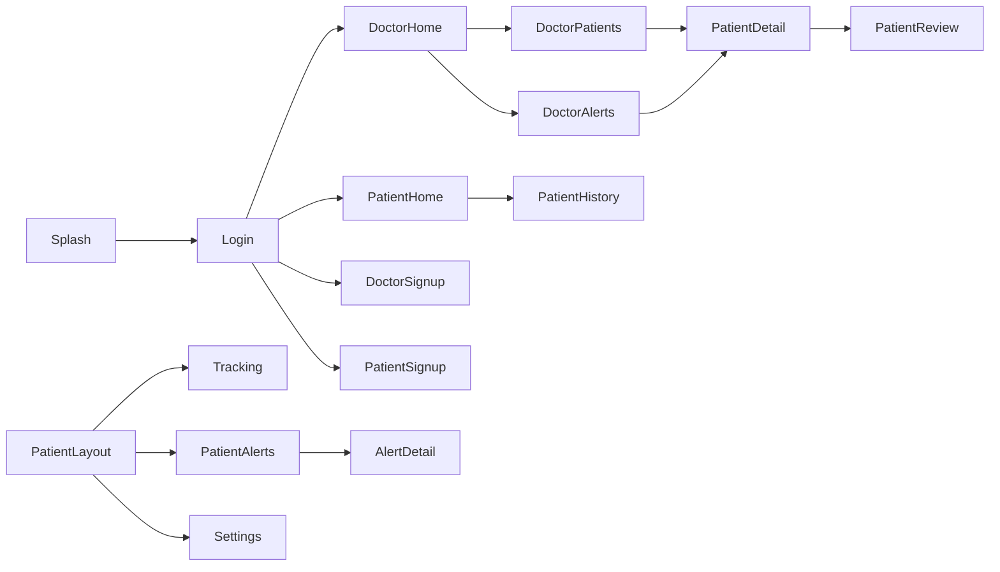
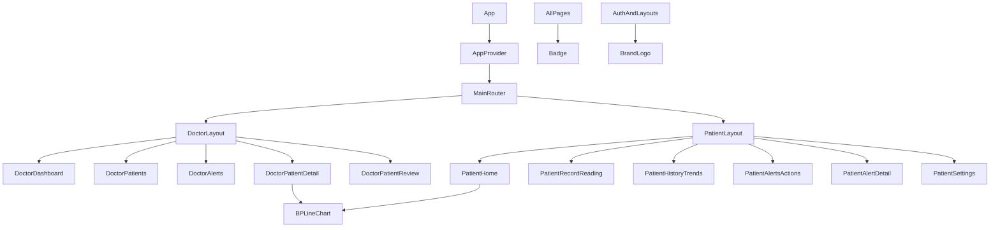

# Frontend Documentation

## 1. Frontend Overview

### Purpose and responsibilities

The frontend is a React showcase/prototype for **روض (Rawd)**, a clinical blood-pressure telemonitoring platform. It presents two role-oriented workspaces:

- **Doctor workspace:** patient prioritization, patient records, alerts, contact-request UI, and a 14-day review.
- **Patient portal:** readings, trends, alerts/actions, device-sync guidance, accessibility settings, and care-team information.
- **Authentication/onboarding:** splash screen, login, and doctor/patient registration screens.

The current implementation is presentation-first. It uses hardcoded clinical data and local React state; it does not authenticate against a server or communicate with a backend. This is directly evidenced by `src/data/mockData.ts`, `src/context/AppContext.tsx`, and the absence of an HTTP service module or network call in `src/`.

### Technology and architecture

- React 19 with functional components and hooks.
- TypeScript with strict-ish compiler checks (`noUnusedLocals`, `noUnusedParameters`, `verbatimModuleSyntax`).
- Vite 8 for development and production bundling.
- Tailwind CSS 4 through `@tailwindcss/vite`.
- `lucide-react` for icons.
- React Context plus `useState`/`useEffect` for the application store.
- `react-router-dom` is declared in `package.json`, but no router, route object, `Link`, or `useNavigate` usage exists in the source.

The architecture is a single application shell with conditional rendering:

```mermaid
flowchart TD
  Browser[index.html] --> Main[main.tsx]
  Main --> App[App.tsx]
  App --> Provider[AppProvider]
  Provider --> Router[MainRouter: conditional view switch]
  Router --> Auth[Auth screens]
  Router --> Doctor[DoctorLayout]
  Router --> Patient[PatientLayout]
  Doctor --> DoctorPages[Dashboard, patients, alerts, detail, review]
  Patient --> PatientPages[Home, tracking, history, alerts, detail, settings]
  Provider --> Mock[mockData.ts]
  Provider --> Types[types/index.ts]
  DoctorPages --> Context[useApp()]
  PatientPages --> Context
  Context -. no network layer .-> Backend[(No backend client)]
```

### Entry point and initialization

`src/main.tsx` imports global CSS, obtains the `#root` element from `index.html`, and renders `<App />` inside `React.StrictMode`. `App.tsx` wraps the body in `AppProvider`, then renders `MainRouter`.

Initial context state is:

- `appView: 'auth'`
- `authView: 'splash'`
- `role: 'doctor'`
- `authRole: 'doctor'`
- doctor and patient subviews set to `home`
- selected patient: `initialPatients[1]` (Marc Dupuis)
- selected doctor alert: `initialDoctorAlerts[0]`
- selected patient alert: `initialPatientAlerts[2]` (device-sync example)
- patient settings: large text, light theme, English

The splash screen automatically changes to login after 2.5 seconds and also advances on click (`components/auth/SplashScreen.tsx`).

### Execution and build

From `Frontend/`:

```bash
bun install
bun run dev
bun run build
bun run lint
bun run preview
```

Equivalent `npm install`, `npm run dev`, `npm run build`, `npm run lint`, and `npm run preview` scripts are available. The configured scripts are in `Frontend/package.json`; Vite configuration is in `Frontend/vite.config.ts`.

## 2. Project Structure

```text
Frontend/
├── index.html                 # Browser document and root mount element
├── package.json               # Dependencies and scripts
├── package-lock.json          # npm lockfile
├── bun.lock                   # Bun lockfile
├── vite.config.ts             # React and Tailwind Vite plugins
├── tsconfig*.json             # TypeScript compiler configuration
├── .oxlintrc.json             # Oxlint plugins and rules
├── public/                    # Public favicon and icon assets
└── src/
    ├── main.tsx               # React entry point
    ├── App.tsx                # Provider, shell, and conditional router
    ├── App.css                # Legacy/Vite-style CSS selectors
    ├── index.css              # Tailwind import, tokens, global styles
    ├── assets/                # Brand logo and Figma/design reference images
    ├── components/
    │   ├── auth/              # Splash, login, and registration views
    │   ├── charts/            # Reusable SVG blood-pressure chart
    │   ├── common/            # Logo, badges, and optional developer nav
    │   ├── doctor/            # Doctor workspace feature views
    │   ├── layout/            # Doctor and patient shells/sidebar navigation
    │   └── patient/           # Patient portal feature views
    ├── context/
    │   └── AppContext.tsx     # Global state, navigation, and mock mutations
    ├── data/
    │   └── mockData.ts        # Patients, alerts, and blood-pressure fixtures
    └── types/
        └── index.ts           # Domain and navigation TypeScript types
```

Important relationships:

- `App.tsx` is the only composition root for pages and layouts.
- Layouts own navigation chrome and call context setters.
- Feature pages consume `useApp()` and generally keep filters, modal state, and transient UI state locally.
- `AppContext.tsx` owns the shared mock collections and mutations.
- `mockData.ts` is the only data source currently used for clinical entities.
- Styling is primarily inline Tailwind utility classes; `index.css` supplies tokens, typography, scrollbars, and the fade-in animation.
- The `assets/UI` PNG files are design references, not runtime data or API resources.

## 3. Application Routing and Navigation

### Routing model

There is no URL routing. `MainRouter` in `App.tsx` switches on `appView`, then on `authView`, `doctorView`, or `patientView`. Browser refresh does not preserve the current view because state is not persisted.

Navigation is performed through:

- Context setters such as `setDoctorView` and `setPatientView`.
- Context helpers such as `navigateToDoctorPatient`, `navigateToDoctorReview`, and `navigateToPatientAlertDetail`.
- Sidebar buttons in `DoctorLayout` and `PatientLayout`.
- The optional `DevNavBar`, currently commented out in `App.tsx`.

No route parameters, query parameters, URL redirects, protected-route component, 404 route, or error route are implemented.

### View table

| Route / state | Page / component | Access requirements | Parameters | Purpose | Status |
|---|---|---|---|---|---|
| `appView=auth, authView=splash` | `SplashScreen` | None | None | Brand/loading entry screen | Implemented UI; timer only |
| `appView=auth, authView=login` | `LoginScreen` | None | None | Role selection and demo login | Mocked authentication |
| `appView=auth, authView=signup_doctor` | `SignUpDoctorScreen` | None | None | Doctor registration form | Placeholder submission |
| `appView=auth, authView=signup_patient` | `SignUpPatientScreen` | None | None | Patient registration form | Placeholder submission |
| `appView=doctor, doctorView=home` | `DoctorDashboard` | Context view state only | None | Patient metrics and prioritized list | Mocked |
| `appView=doctor, doctorView=patients` | `DoctorPatients` | Context view state only | Local search/filter/page state | Search and filter patients | Mocked/local |
| `appView=doctor, doctorView=alerts` | `DoctorAlerts` | Context view state only | Local filter/tab state | Alert inbox and actions | Mocked/local mutations |
| `appView=doctor, doctorView=patient_detail` | `DoctorPatientDetail` | Selected patient in context | Selected ID passed to helper | Patient record, trend, alerts | Mocked |
| `appView=doctor, doctorView=patient_review` | `DoctorPatientReview` | Selected patient in context | Selected ID passed to helper | 14-day review summary | Hardcoded presentation |
| `appView=patient, patientView=home` | `PatientHome` | Context view state only | None | Latest reading and 7-day trend | Mocked |
| `appView=patient, patientView=tracking` | `PatientRecordReading` | Context view state only | None | Manual/continuous reading UI | Local simulation |
| `appView=patient, patientView=history` | `PatientHistoryTrends` | Context view state only | None | Trend chart, filters, log, report action | Mostly hardcoded |
| `appView=patient, patientView=alerts` | `PatientAlertsActions` | Context view state only | None | Filterable example alerts | Mocked |
| `appView=patient, patientView=alert_detail` | `PatientAlertDetail` | Selected alert in context | Selected ID passed to helper | Device-sync guidance | Simulated retry |
| `appView=patient, patientView=settings` | `PatientSettings` | Context view state only | None | Accessibility, device, care settings | Local/simulated |

### Navigation relationships



The diagram represents context view transitions, not browser routes.

## 4. Pages and Features

### Authentication and onboarding

#### Splash

`SplashScreen` displays the Rawd logo, bilingual copy, decorative gradients, an animated loading indicator, and a continue button. It calls `setAuthView('login')` after 2.5 seconds or on user interaction. It does not load configuration, validate a session, or call a backend.

#### Login

`LoginScreen` contains:

- Doctor/patient role toggle.
- Email and password inputs.
- Password visibility toggle.
- Required HTML validation for email/password.
- Forgot-password link that calls `alert()` with a fixed success message.
- Main submit handler that chooses a demo role using the selected role and email substring checks (`doctor`, `clinic`, or `karim`).
- One-click doctor and patient demo buttons.
- Registration navigation.

The entered credentials are not sent anywhere. `loginAsDoctor` and `loginAsPatient` only set context view state.

#### Registration

`SignUpDoctorScreen` renders full name, professional email, password, RPPS/license number, specialization, phone, and terms/protocol consent. `SignUpPatientScreen` renders full name, email, password, date of birth, gender, phone, emergency contact name/phone, and terms/privacy consent.

Only required HTML fields and consent are enforced. The submit handlers discard all field values; if consent is checked they enter the corresponding demo workspace. If consent is not checked they use `alert()`. There is no request payload, duplicate account handling, server validation, or success/error response.

### Doctor workspace

#### Dashboard — `DoctorDashboard`

Displays fixed summary values (148 patients, 12 high/urgent, 18 open alerts), then maps the four mock patients from context into a prioritized table. Clicking a row or “View record” calls `navigateToDoctorPatient`. “Open alerts”, “Go to inbox”, and “View all patients” change the doctor view. The three summary metrics and waiting-contact count are hardcoded and are not derived from context collections.

#### Patient list — `DoctorPatients`

Uses local state for `searchTerm`, `statusFilter`, and `page`. Search matches patient name or code; status filtering matches `clinicalStatus`. The table uses the `patients` context collection and opens a selected patient. Pagination only changes the displayed page indicator; it does not slice results or fetch another page.

#### Alert inbox — `DoctorAlerts`

Uses `doctorAlerts` from context and local `activeTab`, `priorityFilter`, contact-modal, and toast state. Alerts can be selected, filtered by priority, acknowledged, resolved, and linked to a patient record. Acknowledgement updates a boolean in context. Resolution removes the alert from the context collection. The contact-request tab is visual only: it shows a fixed count of 3 and does not render a request dataset. The contact modal presents a local action; no call or message operation is sent.

#### Patient detail — `DoctorPatientDetail`

Uses `selectedPatient` and `marcDpuisReadings`. It shows patient identity, a hardcoded worsening-BP banner, adherence, a reusable `BPLineChart`, recent readings, hardcoded active-alert summaries, condition/medication/target text, and local “contact” and “mark reviewed” toasts. The readings are always Marc Dupuis readings even if another patient is selected, which is an important integration/data-model gap.

#### Patient review — `DoctorPatientReview`

Shows a hardcoded 14-day period, average BP, adherence, alert count, three clinical findings, and morning/evening aggregates. It uses the selected patient only for header identity; all clinical summary values are static. Back navigation returns to patient detail.

### Patient portal

#### Patient home — `PatientHome`

Shows Amina’s latest reading (128/82, pulse 72), a target-range banner, a seven-day trend chart built from an inline array, and a weekly-summary link to history. The data is not read from `aminaReadings`, so the page does not update after a new reading is added.

#### Record reading — `PatientRecordReading`

Supports two local modes:

- **Manual:** numeric systolic, diastolic, and pulse inputs; seven symptom choices; medication-taken toggle; save action.
- **Continuous:** start/stop visual telemetry state, high-reading simulation, and a fixed AI prediction message.

Saving classifies a reading as crisis if SYS >= 180 or DIA >= 120, high if SYS >= 140 or DIA >= 90, otherwise normal. It creates a new context reading with a generated `ar-${Date.now()}` ID, fixed “Today/08:30/Morning” metadata, symptom text as `context`, and `isManual` based on mode. It displays a toast and navigates to history after 1.5 seconds. The medication choice is not included in the saved reading. Continuous mode is a UI simulation, not device integration.

#### History and trends — `PatientHistoryTrends`

Contains local time-range pills (7 days, 14 days, 30 days, 3 months, Custom), morning/evening toggles, fixed trend/stat cards, a hand-authored SVG chart, a detailed log sourced from `aminaReadings`, a consultation summary, and a “send report” action. The time filter and period filter update local state but do not alter the chart or log. Sending a report only shows a toast and does not call a service.

#### Alerts and actions — `PatientAlertsActions`

Filters `patientAlerts` by title/code search, category, and status. It displays an explicit demonstration notice, emergency guidance to call 15 or 112, an alert table, and explanatory cards. Selecting an alert calls `navigateToPatientAlertDetail`. Severity sorting is a non-functional button.

#### Alert detail — `PatientAlertDetail`

Uses the selected patient alert, displays its level/category/code/date/status, and renders device-sync guidance. Retry sync sets a loading state for two seconds, then always reports success after the timeout. The success text claims an OMRON monitor was reconnected, but no Bluetooth or network API is used.

#### Settings — `PatientSettings`

Provides:

- Text-size selection.
- Theme selection.
- English/Arabic language selection.
- Monitoring mode request button.
- Fixed care-team and target information.
- Connected OMRON device card.
- Simulated signal test.
- Privacy/sharing/caregiver presentation.
- Local save toast.

`AppContext` applies only font size and document direction/language. The selected theme is stored in context but no theme class or CSS variable is applied. Device add/recalibrate, monitoring-mode request, caregiver actions, export/save controls, and privacy actions are presentation-only unless noted otherwise. Signal testing is a 1.5-second local timeout that always reports “Signal: 98% (Good).”

## 5. Component Architecture

### Layout and composition

`App` composes `AppProvider` and `MainRouter`. `DoctorLayout` and `PatientLayout` provide responsive fixed/sticky sidebars, mobile menu state, top headers, profile information, logout buttons, and child content slots.



### Reusable components

| Component | Responsibility | Important inputs / dependencies |
|---|---|---|
| `BrandLogo` | Logo image and optional title/subtitle in vertical or horizontal form | `size`, `showTitle`, `showSubtitle`, `subtitleText`, `horizontal`, class names; imports `assets/logo/Logo.png` |
| `Badge` | Semantic status/priority pill styling | `variant`, children, optional icon/class; variant list mirrors clinical status and alert statuses |
| `BPLineChart` | Responsive SVG systolic/diastolic chart with hover guides and optional target band | `data`, target bounds, height, legend, doctor/patient variant |
| `DoctorLayout` | Doctor navigation and selected-patient breadcrumbs | `children`, `useApp()` |
| `PatientLayout` | Patient navigation, language toggle, notification/profile chrome | `children`, `useApp()` |
| `DevNavBar` | Optional showcase navigation across all screens | `useApp()`; imported but commented out in `App.tsx` |

Feature components are not separated into service-connected containers and presentational components; most pages both render UI and mutate context/local state.

### Props and events

Most feature pages have no props and obtain all shared inputs through `useApp()`. Layouts accept only `children`. `BPLineChart` and the common components are the primary reusable prop-driven components. User events are ordinary React button/input handlers; there is no event bus or server mutation abstraction.

## 6. State Management and Data Flow

### Global state

`AppContextType` exposes:

- Role and view state: `role`, `appView`, `authView`, `authRole`, `doctorView`, `patientView`.
- Navigation setters and helpers.
- Patient collection and selected patient.
- Doctor alerts and selected alert.
- Patient alerts and selected alert.
- Amina and Marc reading collections.
- Settings and `updateSettings`.
- Authentication-flow helpers, alert mutations, and reading creation.

The context is initialized once per application mount. No state is persisted to local storage, session storage, cookies, URL, or an external cache.

### Local state

Pages use local state for transient UI concerns:

- Form fields and password visibility.
- Search/filter/pagination values.
- Toasts and modal visibility.
- Chart hover index.
- Manual reading inputs, monitoring mode, AI-prediction text.
- Settings save and device-signal simulation flags.

### Effects and cleanup

- `SplashScreen` installs and cleans up a 2.5-second timer.
- `AppContext` uses an effect to set `document.documentElement.style.fontSize`, `document.body.dir`, and `document.body.lang` when settings change.
- Toast and simulation timers are generally not retained in cleanup functions.

### Representative data flows

#### Doctor patient navigation

1. A table row calls `navigateToDoctorPatient(patient.id)`.
2. The context finds the patient by `id` or `code`.
3. Context updates `selectedPatient`, sets role to doctor, sets `appView='doctor'`, and sets `doctorView='patient_detail'`.
4. `MainRouter` renders `DoctorLayout` and `DoctorPatientDetail`.
5. The detail page reads selected identity from context but reads readings from the fixed `marcDpuisReadings` collection.

#### Patient reading save

1. The user edits local numeric/symptom state.
2. `handleSave` derives a classification from fixed threshold checks.
3. `addAminaReading` adds the record to the front of the in-memory array.
4. A success toast is shown.
5. After 1.5 seconds, the page changes to `patientView='history'`.
6. Only the history log observes the new context reading; dashboard and hardcoded charts do not.

## 7. API Communication and Backend Dependencies

### Network inventory

No `fetch`, Axios client, XMLHttpRequest, WebSocket, GraphQL client, API service, request interceptor, response interceptor, retry library, or backend URL is present under `Frontend/src`. `react-router-dom` is a dependency but is not used for network or routing.

### API operation table

| Feature | Method | Endpoint / URL | Trigger | Headers | Parameters / body | Expected response | Error handling | Source | Status |
|---|---|---|---|---|---|---|---|---|---|
| Login | None | None identified | Login form or demo button | None | Email/password are local only | None | None; role is selected locally | `components/auth/LoginScreen.tsx` — `handleLogin` | Missing backend integration |
| Password reset | None | None identified | Forgot-password link | None | Email is not submitted | Fixed browser alert | None | `components/auth/LoginScreen.tsx` | Placeholder |
| Doctor registration | None | None identified | Doctor form submit | None | Form values are discarded | Local doctor workspace transition | Consent failure uses `alert()` | `components/auth/SignUpDoctorScreen.tsx` — `handleSubmit` | Placeholder |
| Patient registration | None | None identified | Patient form submit | None | Form values are discarded | Local patient portal transition | Consent failure uses `alert()` | `components/auth/SignUpPatientScreen.tsx` — `handleSubmit` | Placeholder |
| Save BP reading | None | None identified | Save reading | None | Stored in context only; shape is `Omit<BPReading,'id'>` | Local history update | No server error path | `components/patient/PatientRecordReading.tsx` — `handleSave`; `context/AppContext.tsx` — `addAminaReading` | Local mock |
| Acknowledge alert | None | None identified | Doctor acknowledgement button | None | Alert ID is local | Local boolean update | None | `context/AppContext.tsx` — `acknowledgeAlert` | Local mock |
| Resolve alert | None | None identified | Doctor resolve button | None | Alert ID is local | Local removal from list | None | `context/AppContext.tsx` — `resolveAlert` | Local mock |
| Device sync retry | None | None identified | Patient retry button | None | None | Always-success timeout simulation | No failure branch | `components/patient/PatientAlertDetail.tsx` — `handleRetrySync` | Simulated |
| Device signal test | None | None identified | Settings test-signal button | None | None | Always “98% (Good)” after timeout | No failure branch | `components/patient/PatientSettings.tsx` — `handleTestSignal` | Simulated |
| Send clinical report | None | None identified | History send-report action | None | None | Toast only | No failure branch | `components/patient/PatientHistoryTrends.tsx` — `handleSendReport` | Placeholder |

### Configuration and transport

No `VITE_*` variables, base URL, environment file reference, credentials mode, bearer token, refresh token, serialization layer, error-normalization shape, timeout, retry, or cache configuration is implemented. A future integration must introduce these deliberately; no current frontend contract should be inferred beyond the TypeScript and mock structures described below.

### Required backend capability candidates

The following are explicit product surfaces in the UI, but their API contracts are unresolved:

- Role-aware login and session establishment.
- Doctor and patient registration.
- Password reset.
- Current-user/profile and role/permission retrieval.
- Doctor patient list/search/filter/pagination.
- Patient detail, readings, adherence, medication, and clinical summaries.
- Doctor alert list, acknowledgement, resolution, and contact requests.
- Patient alert list/detail and alert status/action state.
- Reading submission and historical trend queries.
- Report generation/dispatch.
- Device pairing, sync status, retry, signal test, and telemetry ingestion.
- Patient settings, language/accessibility preferences, care-team association, and caregiver sharing.

These are requirements to resolve against backend documentation, not implemented endpoints.

## 8. Data Models and Type Definitions

The canonical TypeScript declarations are in `Frontend/src/types/index.ts`.

### Navigation types

```ts
type Role = 'doctor' | 'patient';
type DoctorView = 'home' | 'alerts' | 'patients' | 'patient_detail' | 'patient_review';
type PatientView = 'home' | 'tracking' | 'history' | 'alerts' | 'alert_detail' | 'settings';
type AuthView = 'splash' | 'login' | 'signup_doctor' | 'signup_patient';
type AppView = 'auth' | 'doctor' | 'patient';
```

### Patient

```ts
interface Patient {
  id: string;
  code: string;
  name: string;
  initials: string;
  age: number;
  birthDate: string;
  gender: string;
  clinicalStatus: 'crisis' | 'high_priority' | 'urgent' | 'within_target';
  statusLabel: string;
  statusSubtext: string;
  latestSystolic: number;
  latestDiastolic: number;
  latestPulse?: number;
  latestReadingTime: string;
  isTelemonitoring: boolean;
  baselineBP?: string;
  targetBP?: string;
  adherenceRate?: number;
  protocol?: string;
  condition?: string;
  medication?: string;
}
```

### Doctor alert

`DoctorAlert` identifies a patient and contains `id`, patient identity fields, priority (`crisis | high | urgent | under_follow_up`), `priorityLabel`, title/description, relative time, acknowledgement flag, optional morning average/target/adherence/symptom, and `telemonitoring`.

### Patient alert

`PatientAlert` contains `id`, example `code`, level (`emergency | caution | information`), category (`Symptoms | Readings | Device`), title/description, multiline date/time, status (`action_needed | review_needed | check_needed`), labels, and optional numbered troubleshooting `steps`.

### Blood-pressure reading

```ts
interface BPReading {
  id: string;
  date: string;
  time: string;
  period: 'Morning' | 'Evening';
  systolic: number;
  diastolic: number;
  pulse: number;
  context?: string;
  classification: 'normal' | 'borderline' | 'moderately_high' | 'high' | 'crisis';
  classificationLabel: string;
  isManual?: boolean;
}
```

The frontend uses multiple date formats (`Today`, `24 Oct 2024`, `Oct 24`) and free-text context. A backend contract must normalize date/time, timezone, units, measurement source, symptoms, and medication adherence.

### Settings

```ts
interface SettingsState {
  textSize: 'standard' | 'large' | 'extra_large';
  theme: 'light' | 'dark' | 'high_contrast';
  language: 'en' | 'ar';
}
```

### Fixtures and inconsistencies

- `initialPatients` contains four doctor-side patients; the portal displays a separate hardcoded Amina Benali identity (`#TC-4819`) while the fixture patient is Amina Cherif (`AC-502`).
- `selectedPatient` defaults to Marc Dupuis, but the detail page’s readings are always `initialMarcDupuisReadings`.
- The patient portal’s inline charts and cards use values independent of `initialAminaReadings`.
- Registration fields have no request type.
- Medication-taken state is not represented in `BPReading`.
- Device, care-team, report, and review-summary data have no TypeScript domain model.

## 9. Authentication and Authorization

### Implemented

- UI role selection (`doctor`/`patient`).
- Local role state and view switching.
- Logout returns to `authView='login'`.
- Doctor and patient layouts expose logout controls.
- Doctor and patient portals have separate navigation surfaces.

### Not implemented

- Credential verification.
- Token or session acquisition.
- Token storage or attachment.
- Refresh/expiration handling.
- Current-user identity retrieval.
- Server-side role/permission checks.
- Protected routes.
- Unauthorized/forbidden response handling.
- Account creation or password reset.

Displayed identities such as “Dr. Karim B.”, “Amina Benali”, and “Dr. Philippe Laurent” are hardcoded presentation values. The `role` context value is not an authorization boundary.

## 10. Forms, Validation, and User Workflows

| Form / workflow | Fields and rules | Submission behavior | Status |
|---|---|---|---|
| Login | Required email and password; role toggle; password visibility | Selects local doctor/patient view using role/email heuristic | Mocked |
| Doctor registration | Required name, professional email, password, RPPS/license, specialty; optional phone; required consent | Consent checked then enters doctor workspace; values discarded | Placeholder |
| Patient registration | Required name, email, password, consent; optional DOB, gender, phone, emergency contact | Consent checked then enters patient portal; values discarded | Placeholder |
| Manual reading | Numeric SYS/DIA/pulse, one of seven symptoms, medication toggle | Derives classification and adds in-memory `BPReading` | Local mock |
| Patient alert filtering | Search, category, status | Filters local array | Implemented locally |
| Doctor alert actions | Priority filter, select, acknowledge, resolve | Mutates in-memory alerts and shows toast | Local mock |
| Accessibility settings | Text size, theme, language | Updates context; font/direction effect only | Partially implemented |

### Reading workflow

1. Patient opens Blood Pressure Tracking.
2. Manual mode is default; continuous mode is an alternate visual mode.
3. Patient enters three numeric values, chooses a symptom and medication status.
4. Optional “Simulate 165/102” sets a high reading and headache.
5. Save derives classification and inserts a reading into `aminaReadings`.
6. A success toast appears, then history is selected.

### Alert workflow

1. Doctor opens Alerts and may filter by priority.
2. Doctor selects an alert to view details.
3. Doctor may acknowledge it, which sets `isAcknowledged`.
4. Doctor may resolve it, which removes it from the in-memory collection.
5. Patient opens Alerts & Actions, filters examples, and opens an alert detail.
6. Device alert retry always transitions from attempting to success after two seconds.

## 11. Error Handling and Application Feedback

### Present behavior

- Native HTML `required`/`type` validation is used on login and registration fields.
- Missing registration consent uses browser `alert()`.
- Forgot-password uses a fixed browser `alert()`.
- Empty doctor alert filtering has an explicit “No open alerts” state.
- Patient alert and patient-list empty filtering states are limited; no dedicated error state is rendered.
- Loading states are simulated with button text, opacity, spinners, and timeouts.
- Success feedback uses local fixed-position toast banners.
- The `useApp` hook throws an error if used outside `AppProvider`.
- No error boundary is present.
- No HTTP/network/timeout/parse/auth error pipeline exists.
- No unauthorized, forbidden, offline, retry-failure, or server-validation state exists.

### Integration implications

Backend integration must define a normalized error shape and map field-level validation, authentication failures, authorization failures, unavailable devices, network failures, and stale/conflicting updates into explicit UI states. Existing success-shaped simulations must not be treated as evidence of real operation success.

## 12. Configuration, Dependencies, and Execution

### Dependencies

| Dependency | Use |
|---|---|
| `react`, `react-dom` | UI runtime |
| `lucide-react` | Icons |
| `tailwindcss`, `@tailwindcss/vite` | Utility styling and Vite integration |
| `vite`, `@vitejs/plugin-react` | Development server and production build |
| `typescript` | Type checking and compilation |
| `oxlint` | Linting |
| `react-router-dom` | Declared but currently unused |
| `bun` | Declared package dependency and supported package-manager command in README |

### Configuration

- `vite.config.ts` enables Tailwind and React plugins.
- `tsconfig.app.json` targets ES2023, uses bundler module resolution, JSX automatic runtime, no emit, and includes `src`.
- `.oxlintrc.json` enables React, TypeScript, and Oxc plugins, with hooks as an error and component-export rule as a warning.
- `index.css` imports Tailwind and defines brand/surface tokens, body typography, RTL font fallback, scrollbar styles, and `.animate-fadeIn`.
- No frontend environment variables are referenced.
- No production API base URL or deployment-specific configuration is present.

### Assets

The runtime imports `src/assets/logo/Logo.png` through `BrandLogo`. `Logo.svg`, UI screenshots, `public/favicon.svg`, and `public/icons.svg` are static assets/design references. No upload/download or remote asset service is implemented.

## 13. Testing and Quality Assurance

No `*.test.*` or `*.spec.*` files were found under `Frontend/src`, and `package.json` has no test script or test framework dependency. There is no test setup, coverage configuration, component test suite, integration suite, or end-to-end suite identifiable in the frontend.

The configured quality command is:

```bash
cd Frontend
npm run lint
```

The build/type-check command is:

```bash
cd Frontend
npm run build
```

Important untested behavior includes all context mutations, classification thresholds, navigation transitions, empty/filter states, simulated timers, RTL changes, and responsive layouts.

## 14. Integration Readiness Assessment

### A. Existing integration points

There are no actual backend integration points. The frontend’s future integration seams are:

- `AppContext` mutations and selectors in `src/context/AppContext.tsx`.
- Login and registration handlers in `src/components/auth/`.
- Reading submission in `PatientRecordReading`.
- Doctor alert acknowledgement/resolution in `AppContext`.
- Patient/doctor navigation helpers that currently select mock objects.
- Device retry and signal-test handlers in patient components.
- Report dispatch action in `PatientHistoryTrends`.

### B. Required backend capabilities

**Explicit UI dependencies:**

- Authentication for doctor/patient roles.
- Doctor and patient account creation.
- Patient records and readings.
- Clinical status, targets, adherence, medication, and care-team data.
- Doctor alerts and their acknowledgement/resolution lifecycle.
- Patient-facing alerts and action status.
- Device connectivity/sync state.
- Preferences and possibly caregiver-sharing state.

**Inferred requirements that must be confirmed:**

- Pagination and server-side filtering for the claimed 148-patient list.
- A clinical summary/aggregation service for 7-day and 14-day metrics.
- Report generation and delivery.
- Real-time or polling updates for telemetry and alerts.
- Auditability for clinical actions such as acknowledgement, resolution, and review.
- Fine-grained role/clinic/patient authorization.

### C. API contract requirements

The backend contract must settle at least:

1. Authentication request/response, session/token strategy, role claims, expiration, and error format.
2. Registration payloads, consent representation, validation errors, and account activation.
3. Patient identity and record schema, including code, dates, demographics, conditions, medication, target, and monitoring status.
4. Reading schema: numeric units, timestamp/timezone, morning/evening period, source/device, manual flag, symptoms, medication adherence, and classification ownership.
5. Alert schema: priority/level, status, category, patient relationship, timestamps, descriptions, acknowledgement/resolution actors and timestamps.
6. Search/filter/sort/pagination semantics for doctor patients and both alert lists.
7. Clinical summary calculations and date-range semantics.
8. Device sync/pairing/telemetry semantics and retry failure states.
9. Preferences and language/RTL persistence.
10. Report generation/dispatch response and authorization.

### D. Integration gaps

- No HTTP client or service layer.
- No environment-based backend URL.
- No authentication/session implementation.
- No protected routing.
- Registration and password reset are non-functional.
- All patient, alert, reading, review, device, and care-team data is mocked or hardcoded.
- Patient and doctor views are not URL-addressable or refresh-safe.
- Doctor summary cards are not derived from data.
- Doctor detail is not keyed consistently to the selected patient.
- Patient home and history charts are not consistently driven by shared readings.
- History range/time-of-day controls do not change displayed data.
- Pagination does not paginate.
- Contact requests, send-report, device pairing, monitoring mode change, caregiver controls, theme behavior, and several buttons are placeholders.
- Simulated retry/signal/AI outcomes have no failure paths.
- No loading/error/empty states suitable for server operations.
- No backend DTOs, response normalization, cache policy, optimistic-update policy, or conflict handling.
- Date formats, identities, target thresholds, and fixture values are inconsistent across screens.

### E. Unresolved questions

- Which backend owns clinical classification and target thresholds?
- Is the platform multi-clinic, and what scopes can a doctor access?
- Is Amina Benali the intended patient identity, or should the fixture Amina Cherif be used?
- Are reading and alert timestamps UTC, local clinic time, or patient timezone?
- Should device telemetry be real-time, polling, or user-triggered?
- What exact authentication mechanism and storage policy are required?
- Which actions require audit records or clinician confirmation?
- What is the authoritative source for review summaries and adherence?
- Are 15/112 emergency instructions locale-specific?
- Should accessibility/theme/language preferences be account-level or device-level?
- What does “contact patient” mean: phone link, internal message, or task/request?
- What backend response should represent partial device sync or stale readings?
- Which API errors should retain unsaved form input?

## 15. Comprehensive Technical Inventory

### Pages and views

- Auth: `SplashScreen`, `LoginScreen`, `SignUpDoctorScreen`, `SignUpPatientScreen`.
- Doctor: `DoctorDashboard`, `DoctorPatients`, `DoctorAlerts`, `DoctorPatientDetail`, `DoctorPatientReview`.
- Patient: `PatientHome`, `PatientRecordReading`, `PatientHistoryTrends`, `PatientAlertsActions`, `PatientAlertDetail`, `PatientSettings`.

### Layouts and major components

- Layouts: `DoctorLayout`, `PatientLayout`.
- Shared: `BrandLogo`, `Badge`, `DevNavBar`.
- Visualization: `BPLineChart`.

### Services and API clients

- None identified.
- All shared operations are context functions in `AppContext.tsx`.

### Custom hooks and providers

- `useApp` custom context hook.
- `AppProvider` global provider.
- No data-fetching, authentication, persistence, or device hooks.

### Domain entities and types

- `Patient`, `DoctorAlert`, `PatientAlert`, `BPReading`, `SettingsState`.
- Navigation unions: `Role`, `DoctorView`, `PatientView`, `AuthView`, `AppView`.
- Badge variants mirror clinical statuses, alert levels/statuses, reading classifications, and UI-only styles.

### Environment variables

- None referenced.

### API operations

- None implemented.
- Required future operations include auth, registration, password reset, patient/readings/alerts queries, alert mutations, report dispatch, device operations, and preference persistence.

### Authentication

- Local role switch and demo transitions only.
- No tokens, sessions, refresh, claims, protected routes, or authorization checks.

### Mocked and incomplete features

- All clinical datasets in `src/data/mockData.ts`.
- Demo credentials and identities.
- Registration, password reset, contact, report dispatch, continuous monitoring, AI prediction, device sync, signal testing, monitoring-mode requests, caregiver/device management, and many settings actions.
- Hardcoded clinical summaries and chart data.

### Critical integration dependencies

- A stable authenticated user/role model.
- Consistent patient identity and record relationships.
- Reading/alert DTOs that match or intentionally replace the current TypeScript shapes.
- Server-side clinical aggregation and alert lifecycle semantics.
- Device and telemetry integration strategy.
- Explicit error, loading, authorization, audit, and persistence contracts.
