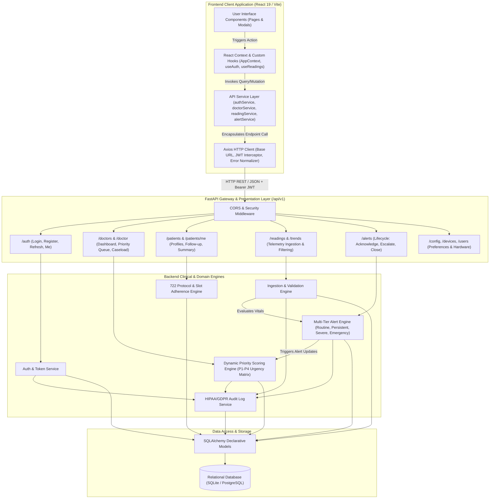
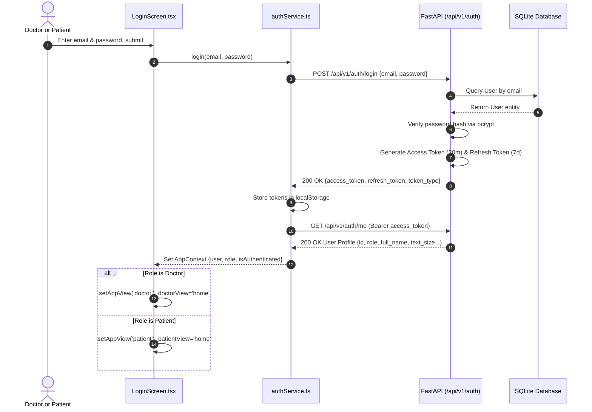
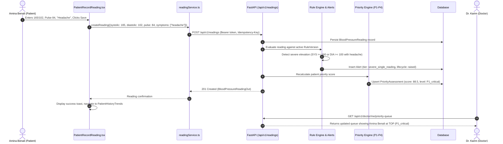
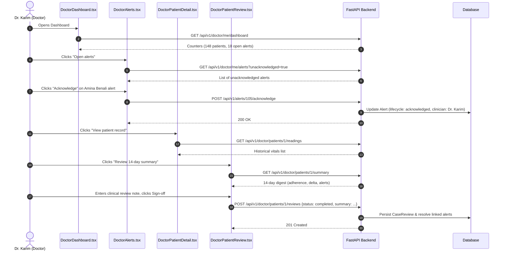
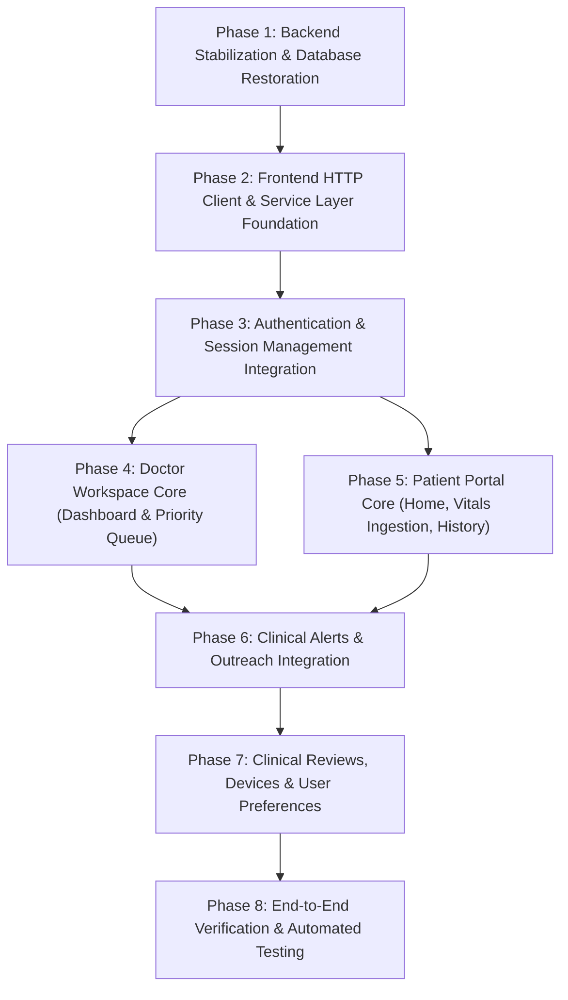

# RAWDH (روض) — Complete Frontend–Backend Integration Specification (`Integration.md`)

**Document Version:** 1.0.0  
**Target Platform:** RAWDH (روض) Hypertension Telemonitoring Platform (v3.0.0)  
**Role:** Definitive Technical Specification & Autonomous Execution Blueprint for Coding Agents  
**Target File Location:** Project Root (`Integration.md`)  

---

## 1. Integration Overview

### 1.1 Purpose of the Integration
The primary objective of this integration is to transform the RAWDH (روض) telemonitoring system from a disconnected presentation prototype into an end-to-end, production-grade clinical telemonitoring platform. 

Currently:
- The **Frontend** is a React 19 + TypeScript + Vite + Tailwind CSS application providing doctor workspaces and patient portals, driven entirely by static mock data (`src/data/mockData.ts`) and local React Context (`src/context/AppContext.tsx`), lacking network transport, authentication, and state persistence.
- The **Backend** is a modular FastAPI + SQLAlchemy v3.0.0 architecture providing 28 domain-specific routers, OAuth2/JWT security, a multi-tier clinical alert engine, algorithmic triage prioritization (P1–P4), schedule slot compliance tracking (722 protocol), medication titration ledgering, and HIPAA/GDPR forensic audit logging.

The integrated architecture binds both layers into a cohesive, secure, and reactive system where user interactions trigger real-time clinical evaluations, persistent database mutations, and bidirectional healthcare provider workflows.

### 1.2 Responsibilities of Frontend and Backend

```
+----------------------------------------------------------------------------------------------------+
|                                      SYSTEM RESPONSIBILITIES                                        |
+-----------------------------------------------------------------+----------------------------------+
| Frontend (Client Presentation & Interaction)                    | Backend (Clinical Authority)     |
+-----------------------------------------------------------------+----------------------------------+
| - UI presentation, bilingual Arabic/English layout & RTL toggles| - Authoritative clinical rules   |
| - Local form validation & input ergonomics                     | - Physiological threshold eval   |
| - Optimistic rendering & UI loading/error states               | - Algorithmic priority score     |
| - Secure token storage & silent bearer injection               | - OAuth2 Bearer JWT lifecycle    |
| - Client-side state hydration from normalized REST endpoints   | - Relational data persistence    |
| - Data visualization via SVG charts (BPLineChart)              | - Forensic audit trail generation|
| - Accessibility preferences enforcement (font sizing, themes)  | - SLA tracking & alert escalation|
+-----------------------------------------------------------------+----------------------------------+
```

### 1.3 Communication Architecture & Protocols
- **Transport Protocol:** HTTP/1.1 (and HTTP/2 supported via reverse proxy) over TLS/HTTPS.
- **Data Exchange Format:** Pure JSON (`application/json; charset=utf-8`).
- **Authentication Protocol:** OAuth2 Bearer Token specification utilizing JSON Web Tokens (JWT) signed with HMAC-SHA256 (`HS256`).
- **Session Lifecycle:** Dual-token mechanism:
  - Short-lived Access Token (30 minutes expiry) transmitted via `Authorization: Bearer <token>` header.
  - Long-lived Refresh Token (7 days expiry) used via `/api/v1/auth/refresh` with database-level revocation checks (`RevokedToken`).
- **Idempotency Safeguard:** Critical ingestion routes (`POST /api/v1/readings`) accept an `Idempotency-Key: <UUIDv4>` header to prevent duplicate telemetry submissions over volatile mobile/cellular connections.
- **Proxy Context Delegation:** Caregiver proxy actions enforce delegation boundaries using the `X-Acting-For: <patient_id>` header.

### 1.4 System Architecture Flow Diagram



### 1.5 Expected Runtime Communication Flow
1. **Bootstrapping:** The client mounts `<App />`, reads persistent auth tokens from `localStorage`, and calls `GET /api/v1/auth/me`.
   - If valid, context state initializes with the verified user, role, and accessibility settings.
   - If invalid or expired, client executes silent refresh or redirects to `LoginScreen`.
2. **Doctor Session Initiation:**
   - Client queries `GET /api/v1/doctor/me/dashboard` to populate aggregate metric cards (total patients, high/urgent alerts, open alerts, waiting contacts).
   - Client queries `GET /api/v1/doctor/me/priority-queue?page=1&page_size=20` to populate the real-time triage queue sorted by clinical risk.
3. **Patient Physiological Submission:**
   - Patient records blood pressure and pulse on `PatientRecordReading`.
   - Client posts payload to `POST /api/v1/readings` with `Idempotency-Key`.
   - Backend evaluates systolic/diastolic thresholds, checks against protocol slots, determines alerts, updates priority scores, and returns full observation record.
   - Frontend appends reading, triggers alert notifications, and invalidates trend caches.

---

## 2. Integration Principles and Technical Decisions

### 2.1 Ownership of Business Logic
**The Backend is the single authoritative source of truth for all business and clinical logic.**
- **Clinical Triage & Alerting:** The frontend MUST NOT calculate alert tiers, clinical priority scores (P1–P4), or SLA escalations. All thresholds (e.g., Systolic ≥ 180 mmHg or Diastolic ≥ 120 mmHg triggering `severe_single_reading`) are computed server-side by `alert_service` and `priority_service`.
- **Adherence & Compliance:** The frontend presents adherence metrics calculated by `coverage_service` and `slot_service` based on prescribed measurement schedules (e.g., 722 diagnostic protocol).
- **Target Thresholds:** Clinical targets are established by doctors via backend endpoints and fetched per patient.

### 2.2 Ownership of Data Validation
- **Client-Side (UX Only):** Frontend performs immediate, non-blocking input validation (format checks, email syntax, numeric limits, password strength) to prevent unnecessary roundtrips.
- **Server-Side (Authoritative Enforcement):** Backend validates all incoming payloads via Pydantic v2 schemas (`app/schemas/`). Server validation checks physiological plausibility (e.g., systolic between 50 and 300 mmHg, pulse between 30 and 250 bpm). If server validation fails, HTTP `422 Unprocessable Entity` or `400 Bad Request` is returned, and the frontend maps field-level errors to UI inputs.

### 2.3 API Communication Conventions
- **Endpoint Structure:** All API routes are namespaced under `/api/v1`.
- **Casing Convention:** 
  - Wire protocol: JSON payloads use `snake_case` (e.g., `is_active`, `measured_at`, `patient_id`).
  - Frontend TypeScript layer: Normalizes incoming `snake_case` properties to `camelCase` at the service/adapter boundary, or retains strongly typed snake_case interfaces matching backend DTOs.
- **Date/Time Formatting:** All timestamps across the API MUST be ISO 8601 strings in UTC (`YYYY-MM-DDTHH:mm:ssZ`).
- **HTTP Status Codes:**
  - `200 OK`: Successful read or synchronous update.
  - `201 Created`: Successful entity creation (registration, reading ingestion, device pairing).
  - `204 No Content`: Successful deletion/unpairing with no response body.
  - `400 Bad Request`: Business rule violation or malformed request syntax.
  - `401 Unauthorized`: Missing, invalid, or expired JWT token.
  - `403 Forbidden`: Authenticated user lacks required role (e.g., patient attempting to access doctor dashboard).
  - `404 Not Found`: Target resource does not exist or user lacks assignment access.
  - `409 Conflict`: Resource state conflict (e.g., active assignment exists, slot already confirmed).
  - `422 Unprocessable Entity`: Pydantic schema validation error or rejected physiological value.

### 2.4 Error Handling and Normalization Responsibilities
The frontend HTTP client must normalize all network, HTTP, and validation errors into a single, predictable structure:
```typescript
interface NormalizedApiError {
  status: number;
  message: string;
  code?: string;
  validationErrors?: Record<string, string>;
}
```
All UI views must handle loading, empty, and error states gracefully without application crashes.

### 2.5 Authentication and Session Management
- **Storage:** Access token and refresh token are stored securely in `localStorage` under keys `rawd_access_token` and `rawd_refresh_token`.
- **Request Interception:** The API client intercepts every outgoing request and injects `Authorization: Bearer <access_token>`.
- **Response Interception (Silent Refresh):** Upon receiving a `401 Unauthorized`, the client queues pending requests, invokes `POST /api/v1/auth/refresh`, updates the stored token, and retries the failed requests. If the refresh call fails, the session is cleared, and the application switches to `authView='login'`.

### 2.6 Security Boundaries & Separation of Concerns
- **Client Role Claims are Untrusted:** UI rendering decisions (hiding buttons or tabs) are convenience features only. The backend enforces strict role-based access control (RBAC) via FastAPI dependencies (`get_current_doctor`, `get_current_patient`, `get_current_admin`).
- **Doctor-Patient Boundary:** A doctor can only access records of patients explicitly linked via `DoctorPatientAssignment`. Server checks (`check_patient_access`) enforce this boundary on every clinical endpoint.

---

## 3. Complete Feature-to-Endpoint Mapping

| Frontend Feature | Frontend Page / Component | Frontend Service / Hook | Required Backend Capability | Backend Endpoint | HTTP Verb | Access Role | Status & Required Changes |
| :--- | :--- | :--- | :--- | :--- | :--- | :--- | :--- |
| **Doctor Login** | `LoginScreen.tsx` | `authService.login()` | Verify credentials & issue JWT tokens | `/api/v1/auth/login` | `POST` | Public | **Not integrated.** Replace hardcoded role toggle with real credentials submission. |
| **Patient Login** | `LoginScreen.tsx` | `authService.login()` | Verify credentials & issue JWT tokens | `/api/v1/auth/login` | `POST` | Public | **Not integrated.** Replace demo mock login with authentication client. |
| **Session Hydration** | `App.tsx`, `AppContext.tsx` | `authService.getMe()` | Fetch authenticated user context & profile | `/api/v1/auth/me` | `GET` | Authenticated | **Not integrated.** Implement on app mount to persist sessions across page reloads. |
| **Doctor Registration** | `SignUpDoctorScreen.tsx` | `authService.registerDoctor()` | Create user account and doctor profile | `/api/v1/auth/register` + `/api/v1/doctors` | `POST` | Public / Admin | **Partially supported.** Backend supports admin-created doctor profile; register endpoint provides user creation. |
| **Patient Registration** | `SignUpPatientScreen.tsx` | `authService.registerPatient()` | Enrol patient user & clinical profile | `/api/v1/auth/register` + `/api/v1/patients/me` | `POST` | Public / Patient | **Partially supported.** Connect form submission to backend registration & profile setup. |
| **Password Reset** | `LoginScreen.tsx` | `authService.forgotPassword()` | Dispatch password reset token | `/api/v1/auth/forgot-password` | `POST` | Public | **Not integrated.** Replace `alert()` with API call. |
| **Doctor Dashboard Metrics** | `DoctorDashboard.tsx` | `doctorService.getDashboard()` | Retrieve caseload count, alerts breakdown, contact tasks | `/api/v1/doctor/me/dashboard` | `GET` | Doctor | **Not integrated.** Replace hardcoded 148 patients / 18 alerts with dynamic response. |
| **Doctor Priority Queue** | `DoctorDashboard.tsx`, `DoctorPatients.tsx` | `doctorService.getPriorityQueue()` | Fetch patients ordered by triage urgency score | `/api/v1/doctor/me/priority-queue` | `GET` | Doctor | **Not integrated.** Replace static `patients` array with server-calculated priority queue. |
| **Doctor Patient List** | `DoctorPatients.tsx` | `doctorService.getAssignedPatients()` | Fetch doctor's assigned patient directory | `/api/v1/doctor/me/patients` | `GET` | Doctor | **Not integrated.** Connect search, filter, and pagination to backend parameters. |
| **Patient Clinical Detail** | `DoctorPatientDetail.tsx` | `patientService.getPatientDetail()` | Retrieve full clinical profile and baseline targets | `/api/v1/doctor/patients/{id}` | `GET` | Doctor | **Not integrated.** Replace static Marc Dupuis fixture with selected patient ID. |
| **Patient Detail Vitals** | `DoctorPatientDetail.tsx` | `readingService.getPatientReadings()` | Retrieve historical BP readings for patient | `/api/v1/doctor/patients/{id}/readings` | `GET` | Doctor | **Not integrated.** Replace fixed `marcDpuisReadings` with dynamic readings query. |
| **Patient Detail Trends** | `DoctorPatientDetail.tsx` | `readingService.getDoctorTrends()` | Trend graph data with event overlays | `/api/v1/doctor/patients/{id}/trends` | `GET` | Doctor | **Not integrated.** Feed `BPLineChart` from backend trend service. |
| **Patient 14-Day Review** | `DoctorPatientReview.tsx` | `patientService.getPreReviewSummary()` | Pre-review clinical digest (delta, adherence, aggregates) | `/api/v1/doctor/patients/{id}/summary` | `GET` | Doctor | **Not integrated.** Replace hardcoded 154/94 and 86% adherence with digest data. |
| **Submit Case Review** | `DoctorPatientReview.tsx` | `reviewService.createReview()` | Save clinical sign-off, notes & follow-ups | `/api/v1/doctor/patients/{id}/reviews` | `POST` | Doctor | **Not integrated.** Add review submission form & sign-off mutation. |
| **Doctor Alerts List** | `DoctorAlerts.tsx` | `alertService.getDoctorAlerts()` | Fetch alerts across assigned caseload | `/api/v1/doctor/me/alerts` | `GET` | Doctor | **Not integrated.** Connect tab and priority filters to backend query parameters. |
| **Alert Acknowledgment** | `DoctorAlerts.tsx`, `AppContext.tsx` | `alertService.acknowledgeAlert()` | Clinician acknowledges alert (stops SLA timer) | `/api/v1/alerts/{id}/acknowledge` | `POST` | Doctor | **Not integrated.** Replace context boolean flip with API call. |
| **Alert Resolution / Close**| `DoctorAlerts.tsx`, `AppContext.tsx` | `alertService.closeAlert()` | Resolve alert with clinical resolution notes | `/api/v1/alerts/{id}/close` | `POST` | Doctor | **Not integrated.** Replace context array filter with API call. |
| **Doctor Contact Tasks** | `DoctorAlerts.tsx` | `doctorService.getContactRequests()` | Retrieve list of open outreach tasks | `/api/v1/doctor/me/contact-requests` | `GET` | Doctor | **Not integrated.** Connect "Contact requests · 3" tab to real task list. |
| **Initiate Patient Contact**| `DoctorPatientDetail.tsx`, `DoctorAlerts.tsx` | `doctorService.initiateContact()` | Create an outreach task for a patient | `/api/v1/doctor/patients/{id}/contact-requests` | `POST` | Doctor | **Not integrated.** Wire modal and button to backend creation. |
| **Patient Home Vitals** | `PatientHome.tsx` | `patientService.getOwnSummary()` | Latest reading, target range, cycle progress | `/api/v1/patients/me/summary` | `GET` | Patient | **Not integrated.** Replace hardcoded 128/82 with dynamic summary. |
| **Patient 7-Day Trend** | `PatientHome.tsx` | `readingService.getOwnTrends()` | 7-day morning session average trend points | `/api/v1/patients/me/trends?range=7d`| `GET` | Patient | **Not integrated.** Bind `BPLineChart` to backend trend data. |
| **Patient Record Reading** | `PatientRecordReading.tsx`| `readingService.createReading()` | Ingest BP reading, link slot, evaluate rules | `/api/v1/readings` | `POST` | Patient | **Not integrated.** Replace local context mutation with POST call. |
| **Patient Readings Log** | `PatientHistoryTrends.tsx` | `readingService.getOwnReadings()` | Historical readings log with time filters | `/api/v1/patients/me/readings` | `GET` | Patient | **Not integrated.** Replace `initialAminaReadings` with paginated query. |
| **Patient Trend Charts** | `PatientHistoryTrends.tsx` | `readingService.getOwnTrends()` | Multi-range trend data (7d, 30d, 90d) | `/api/v1/patients/me/trends` | `GET` | Patient | **Not integrated.** Connect range selector pills to API call. |
| **Patient Export Report** | `PatientHistoryTrends.tsx` | `reportService.previewReport()` | Structured PDF/printable report preview | `/api/v1/doctor/patients/{id}/reports/preview` | `GET` | Doctor/Patient | **Requires modification.** Enable patient self-service or proxy report preview. |
| **Patient Alerts List** | `PatientAlertsActions.tsx` | `alertService.getOwnAlerts()` | Active patient safety alerts with plain text | `/api/v1/patients/me/alerts` | `GET` | Patient | **Not integrated.** Replace `initialPatientAlerts` with live endpoint. |
| **Patient Confirm Alert** | `PatientAlertDetail.tsx` | `alertService.patientAcknowledge()`| Confirm patient has read emergency guidance | `/api/v1/alerts/{id}/patient-acknowledge` | `POST` | Patient | **Not integrated.** Wire confirmation button to API call. |
| **Patient Device Sync** | `PatientAlertDetail.tsx`, `PatientSettings.tsx` | `deviceService.getOwnDevices()` | List paired monitors and sync status | `/api/v1/patients/me/devices` | `GET` | Patient | **Not integrated.** Replace static OMRON card with real device state. |
| **Patient Settings Preferences**| `PatientSettings.tsx` | `userService.updatePreferences()` | Persist text size, theme, locale | `/api/v1/users/me` | `PATCH` | Patient / All | **Not integrated.** Persist accessibility preferences to user entity. |
| **Patient Care-Team Info** | `PatientSettings.tsx` | `patientService.getOwnFollowUp()` | Retrieve assigned doctor, target, protocol | `/api/v1/patients/me/follow-up` | `GET` | Patient | **Not integrated.** Replace hardcoded "Dr. Philippe Laurent" with actual doctor info. |
| **Request Mode Change** | `PatientSettings.tsx` | `patientService.requestModeChange()`| Request protocol tier transition | `/api/v1/patients/me/monitoring-mode-requests` | `POST` | Patient | **Not integrated.** Wire modal form to backend endpoint. |

---

## 4. Complete API Integration Contract

### Operation 1: Authenticate User (Login)
- **Feature:** Authentication for doctors and patients.
- **Method:** `POST`
- **Endpoint:** `/api/v1/auth/login`
- **Authentication:** None (Public)
- **Authorization:** None
- **Request Headers:** `Content-Type: application/json`
- **Request Body:**
```json
{
  "email": "dr.karim@clinic.com",
  "password": "Password123!"
}
```
- **Expected Success Response (200 OK):**
```json
{
  "access_token": "eyJhbGciOiJIUzI1NiIsInR5cCI6IkpXVCJ9...",
  "refresh_token": "eyJhbGciOiJIUzI1NiIsInR5cCI6IkpXVCJ9...",
  "token_type": "bearer",
  "expires_in": 1800
}
```
- **Expected Error Responses:**
  - `401 Unauthorized`: `{"detail": "Incorrect email or password, or account is inactive"}`
  - `422 Unprocessable Entity`: Validation failure on email or password field.
- **Frontend Caller:** `src/services/authService.ts` via `LoginScreen.tsx`.
- **Backend Implementation:** `Backend/app/routes/auth_route.py` -> `login()`, `Backend/app/services/auth_service.py` -> `login_user()`.
- **Integration Changes:** Store tokens in `localStorage`; decode user role to set `appView` (`doctor` vs `patient`).

---

### Operation 2: Get Current User Identity & Profile
- **Feature:** Session rehydration and user context verification on boot.
- **Method:** `GET`
- **Endpoint:** `/api/v1/auth/me`
- **Authentication:** Required
- **Request Headers:** `Authorization: Bearer <access_token>`
- **Expected Success Response (200 OK):**
```json
{
  "id": 1,
  "email": "dr.karim@clinic.com",
  "full_name": "Dr. Karim B.",
  "role": "doctor",
  "is_active": true,
  "email_verified": true,
  "phone": "+213555123456",
  "locale": "en",
  "text_size": 100,
  "theme": "light",
  "high_contrast": false
}
```
- **Expected Error Responses:**
  - `401 Unauthorized`: Token invalid, revoked, or expired.
- **Frontend Caller:** `src/services/authService.ts` called in `App.tsx` on initialization.
- **Backend Implementation:** `Backend/app/routes/auth_route.py` -> `get_me()`.

---

### Operation 3: Refresh Access Token
- **Feature:** Silent refresh when access token expires.
- **Method:** `POST`
- **Endpoint:** `/api/v1/auth/refresh`
- **Authentication:** Public (Carries refresh token in body)
- **Request Body:**
```json
{
  "refresh_token": "eyJhbGciOiJIUzI1NiIsInR5cCI6IkpXVCJ9..."
}
```
- **Expected Success Response (200 OK):**
```json
{
  "access_token": "eyJhbGciOiJIUzI1NiIsInR5cCI6IkpXVCJ9...",
  "refresh_token": "eyJhbGciOiJIUzI1NiIsInR5cCI6IkpXVCJ9...",
  "token_type": "bearer",
  "expires_in": 1800
}
```
- **Expected Error Responses:**
  - `401 Unauthorized`: `{"detail": "Invalid or revoked refresh token"}`
- **Frontend Caller:** Axios response interceptor in `src/services/apiClient.ts`.
- **Backend Implementation:** `Backend/app/routes/auth_route.py` -> `refresh_token()`.

---

### Operation 4: Get Doctor Dashboard Metrics
- **Feature:** Doctor dashboard aggregate counters.
- **Method:** `GET`
- **Endpoint:** `/api/v1/doctor/me/dashboard`
- **Authentication:** Required
- **Authorization:** Role `doctor`
- **Request Headers:** `Authorization: Bearer <access_token>`
- **Expected Success Response (200 OK):**
```json
{
  "doctor_id": 1,
  "active_patient_count": 148,
  "unacknowledged_alerts_count": 18,
  "alerts_by_tier": {
    "critical_emergency": 3,
    "severe_single_reading": 9,
    "persistent_elevation": 4,
    "routine_out_of_range": 2
  },
  "open_contact_requests_count": 3
}
```
- **Frontend Caller:** `src/services/doctorService.ts` in `DoctorDashboard.tsx`.
- **Backend Implementation:** `Backend/app/routes/priority_route.py` -> `get_doctor_dashboard()`.

---

### Operation 5: Get Doctor Priority Triage Queue
- **Feature:** Prioritized care queue sorted by clinical risk score.
- **Method:** `GET`
- **Endpoint:** `/api/v1/doctor/me/priority-queue`
- **Authentication:** Required
- **Authorization:** Role `doctor`
- **Query Parameters:**
  - `search` (string, optional): Search by patient name or ID.
  - `priority_level` (array of string, optional): `P1_critical`, `P2_high`, `P3_moderate`, `P4_routine`.
  - `alert_tier` (array of string, optional): `critical_emergency`, `severe_single_reading`, etc.
  - `page` (integer, default: 1).
  - `page_size` (integer, default: 20).
- **Expected Success Response (200 OK):**
```json
{
  "items": [
    {
      "patient_id": 2,
      "first_name": "Marc",
      "last_name": "Dupuis",
      "priority_level": "P1_critical",
      "score": 88.5,
      "reasons": ["severe_alert", "systolic_spike", "adherence_drop"],
      "alert_tier": "severe_single_reading",
      "last_reading": {
        "systolic": 185,
        "diastolic": 115,
        "measured_at": "2026-10-30T20:10:00Z"
      },
      "target": {
        "systolic": 135,
        "diastolic": 85
      }
    }
  ],
  "page": 1,
  "page_size": 20,
  "total": 148
}
```
- **Frontend Caller:** `src/services/doctorService.ts` in `DoctorDashboard.tsx` and `DoctorPatients.tsx`.
- **Backend Implementation:** `Backend/app/routes/priority_route.py` -> `get_priority_queue_route()`.

---

### Operation 6: Get Assigned Patient Clinical Detail
- **Feature:** Detailed clinical view for an individual patient.
- **Method:** `GET`
- **Endpoint:** `/api/v1/doctor/patients/{id}`
- **Authentication:** Required
- **Authorization:** Role `doctor` (Must be assigned to patient)
- **Path Parameters:** `id` (integer) — Patient profile ID.
- **Expected Success Response (200 OK):**
```json
{
  "id": 2,
  "user_id": 5,
  "first_name": "Marc",
  "last_name": "Dupuis",
  "date_of_birth": "1958-03-15",
  "gender": "male",
  "age_band": "65-79",
  "under_treatment": true,
  "target_systolic": 135,
  "target_diastolic": 85,
  "baseline_systolic": 142,
  "baseline_diastolic": 86,
  "enrolment_status": "active",
  "emergency_contact_name": "Claire Dupuis",
  "emergency_contact_phone": "+213555987654"
}
```
- **Frontend Caller:** `src/services/patientService.ts` in `DoctorPatientDetail.tsx`.
- **Backend Implementation:** `Backend/app/routes/patient_route.py` -> `doctor_get_patient()`.

---

### Operation 7: Get Doctor Pre-Review Summary (14-Day Digest)
- **Feature:** Structured clinical digest for the 14-day case review.
- **Method:** `GET`
- **Endpoint:** `/api/v1/doctor/patients/{id}/summary`
- **Authentication:** Required
- **Authorization:** Role `doctor`
- **Path Parameters:** `id` (integer) — Patient ID.
- **Expected Success Response (200 OK):**
```json
{
  "patient_id": 2,
  "first_name": "Marc",
  "last_name": "Dupuis",
  "age_band": "65-79",
  "under_treatment": true,
  "target": { "systolic": 135, "diastolic": 85 },
  "adherence_30d": 86.4,
  "active_alerts_count": 2,
  "cycle_progress": {
    "total_slots": 28,
    "completed_slots": 24,
    "cycle_day": 12,
    "cycle_length": 14
  },
  "priority": {
    "level": "P1_critical",
    "score": 88.5,
    "reasons": ["severe_alert"]
  },
  "data_quality_prompts": []
}
```
- **Frontend Caller:** `src/services/patientService.ts` in `DoctorPatientReview.tsx`.
- **Backend Implementation:** `Backend/app/routes/patient_route.py` -> `doctor_get_pre_review_summary()`.

---

### Operation 8: Ingest Blood Pressure Reading
- **Feature:** Patient manual or device vitals recording.
- **Method:** `POST`
- **Endpoint:** `/api/v1/readings`
- **Authentication:** Required
- **Authorization:** Role `patient` or `caregiver`
- **Request Headers:**
  - `Authorization: Bearer <access_token>`
  - `Content-Type: application/json`
  - `Idempotency-Key: <UUIDv4>` (Optional but recommended)
- **Request Body:**
```json
{
  "systolic": 165,
  "diastolic": 102,
  "pulse": 84,
  "measured_at": "2026-10-30T08:30:00Z",
  "capture_method": "manual",
  "arm": "left",
  "posture": "sitting",
  "symptoms_reported": ["headache"]
}
```
- **Expected Success Response (201 Created):**
```json
{
  "id": 401,
  "patient_id": 1,
  "systolic": 165,
  "diastolic": 102,
  "pulse": 84,
  "measured_at": "2026-10-30T08:30:00Z",
  "capture_method": "manual",
  "verification_status": "verified",
  "is_crisis": false,
  "classification": "high",
  "symptoms_reported": ["headache"],
  "created_at": "2026-10-30T08:30:05Z"
}
```
- **Expected Error Responses:**
  - `422 Unprocessable Entity`: Out of biological bounds (e.g., systolic < 50 or > 300).
- **Frontend Caller:** `src/services/readingService.ts` in `PatientRecordReading.tsx`.
- **Backend Implementation:** `Backend/app/routes/reading_route.py` -> `patient_create_reading()`.

---

### Operation 9: Get Patient Home Summary
- **Feature:** Patient portal landing dashboard.
- **Method:** `GET`
- **Endpoint:** `/api/v1/patients/me/summary`
- **Authentication:** Required
- **Authorization:** Role `patient`
- **Expected Success Response (200 OK):**
```json
{
  "patient_id": 1,
  "enrolment_status": "active",
  "latest_reading": {
    "systolic": 128,
    "diastolic": 82,
    "pulse": 72,
    "measured_at": "2026-10-30T08:10:00Z"
  },
  "target": { "systolic": 130, "diastolic": 80 },
  "is_within_target": true,
  "adherence_rate": 92.5,
  "active_alert_count": 0
}
```
- **Frontend Caller:** `src/services/patientService.ts` in `PatientHome.tsx`.
- **Backend Implementation:** `Backend/app/routes/patient_route.py` -> `get_own_summary()`.

---

### Operation 10: Get Patient Trends (7d / 30d / 90d)
- **Feature:** Patient trend chart and morning/evening aggregation.
- **Method:** `GET`
- **Endpoint:** `/api/v1/patients/me/trends`
- **Authentication:** Required
- **Query Parameters:** `range` (string: `7d`, `30d`, `90d`, default: `30d`).
- **Expected Success Response (200 OK):**
```json
{
  "patient_id": 1,
  "time_range": "7d",
  "target_band": { "min": 115, "max": 130 },
  "readings": [
    {
      "date": "2026-10-24",
      "period": "morning",
      "systolic": 128,
      "diastolic": 82,
      "pulse": 72,
      "is_manual": true
    }
  ],
  "delta_from_baseline": -6
}
```
- **Frontend Caller:** `src/services/readingService.ts` in `PatientHome.tsx` and `PatientHistoryTrends.tsx`.
- **Backend Implementation:** `Backend/app/routes/reading_route.py` -> `get_own_trends()`.

---

### Operation 11: Acknowledge Alert (Doctor)
- **Feature:** Stop escalation timer and mark alert acknowledged.
- **Method:** `POST`
- **Endpoint:** `/api/v1/alerts/{id}/acknowledge`
- **Authentication:** Required
- **Authorization:** Role `doctor`
- **Path Parameters:** `id` (integer) — Alert ID.
- **Request Body:**
```json
{
  "decision": "monitor_closely",
  "note": "Reviewed elevated morning reading; awaiting evening slot."
}
```
- **Expected Success Response (200 OK):**
```json
{
  "id": 105,
  "lifecycle": "acknowledged",
  "acknowledged_at": "2026-10-30T09:15:00Z",
  "acknowledged_by": 1
}
```
- **Frontend Caller:** `src/services/alertService.ts` in `DoctorAlerts.tsx`.
- **Backend Implementation:** `Backend/app/routes/alert_route.py` -> `acknowledge_alert_route()`.

---

### Operation 12: Close / Resolve Alert (Doctor)
- **Feature:** Resolve alert following clinical action.
- **Method:** `POST`
- **Endpoint:** `/api/v1/alerts/{id}/close`
- **Authentication:** Required
- **Authorization:** Role `doctor`
- **Path Parameters:** `id` (integer) — Alert ID.
- **Request Body:**
```json
{
  "clinical_note": "Titrated Amlodipine to 10mg; BP stabilized under target."
}
```
- **Expected Success Response (200 OK):**
```json
{
  "id": 105,
  "lifecycle": "closed",
  "closed_at": "2026-10-30T10:00:00Z",
  "clinical_note": "Titrated Amlodipine to 10mg; BP stabilized under target."
}
```
- **Frontend Caller:** `src/services/alertService.ts` in `DoctorAlerts.tsx`.
- **Backend Implementation:** `Backend/app/routes/alert_route.py` -> `close_alert_route()`.

---

### Operation 13: Update User Accessibility Preferences
- **Feature:** Persist text size, theme, and language across devices.
- **Method:** `PATCH`
- **Endpoint:** `/api/v1/users/me`
- **Authentication:** Required
- **Request Body:**
```json
{
  "locale": "ar",
  "text_size": 125,
  "theme": "light",
  "high_contrast": false
}
```
- **Expected Success Response (200 OK):**
```json
{
  "id": 1,
  "locale": "ar",
  "text_size": 125,
  "theme": "light",
  "high_contrast": false
}
```
- **Frontend Caller:** `src/services/userService.ts` in `PatientSettings.tsx`.
- **Backend Implementation:** `Backend/app/routes/user_route.py` -> `update_own_preferences()`.

---

## 5. Data Model Mapping and Transformation

### 5.1 Patient Entity Mapping
| Concept | Frontend Property (`Patient`) | Frontend Type | Backend Property (`PatientProfile`) | Backend Type | Transformation / Conversion Logic |
| :--- | :--- | :--- | :--- | :--- | :--- |
| **Identifier** | `id` | `string` | `id` | `int` | Stringify integer ID on read (`String(profile.id)`); parse to `int` when sending requests. |
| **Code** | `code` | `string` | `id` / custom code | `string` | Generate `#TC-<id>` or use patient code. |
| **Name** | `name` | `string` | `first_name` + `last_name` | `str` | Combine: `${profile.first_name} ${profile.last_name}`. |
| **Initials** | `initials` | `string` | Derived | `str` | Derive: `${first_name[0]}${last_name[0]}`. |
| **Birth Date** | `birthDate` | `string` | `date_of_birth` | `date` | Format date to `DD MMM YYYY` (e.g., `14 May 1964`). |
| **Clinical Status** | `clinicalStatus` | `'crisis' \| 'high_priority' \| 'urgent' \| 'within_target'` | `priority_level` | `str` | Map: `P1_critical` -> `crisis`; `P2_high` -> `high_priority`; `P3_moderate` -> `urgent`; `P4_routine` -> `within_target`. |
| **Status Label** | `statusLabel` | `string` | Derived | `str` | Map: `P1_critical` -> `"Crisis"`; `P2_high` -> `"High Priority"`; `P3_moderate` -> `"Urgent"`; `P4_routine` -> `"Within Target"`. |
| **Target BP** | `targetBP` | `string` | `target_systolic`, `target_diastolic` | `int`, `int` | Format: `${target_systolic}/${target_diastolic} mmHg`. |
| **Baseline BP** | `baselineBP` | `string` | `baseline_systolic`, `baseline_diastolic`| `int`, `int` | Format: `${baseline_systolic}/${baseline_diastolic} mmHg`. |
| **Adherence** | `adherenceRate` | `number` | Calculated Adherence | `float` | Direct percentage (`86.4`). |
| **Monitoring Mode**| `isTelemonitoring` | `boolean` | `monitoring_mode` | `str` | True if `mode == 'telemonitoring'`, false otherwise. |

### 5.2 Blood Pressure Reading Mapping
| Concept | Frontend Property (`BPReading`) | Frontend Type | Backend Property (`BloodPressureReading`) | Backend Type | Transformation / Conversion Logic |
| :--- | :--- | :--- | :--- | :--- | :--- |
| **Identifier** | `id` | `string` | `id` | `int` | Stringify integer ID on ingestion / read. |
| **Date** | `date` | `string` | `measured_at` | `datetime` | Format `measured_at` to human date (`"Today"`, `"24 Oct 2024"`). |
| **Time** | `time` | `string` | `measured_at` | `datetime` | Format `measured_at` to `"HH:mm"`. |
| **Period** | `period` | `'Morning' \| 'Evening'` | `session_window` | `str` | Capitalize: `slot.slot_type.capitalize()`. |
| **Systolic** | `systolic` | `number` | `systolic` | `int` | Direct integer mmHg. |
| **Diastolic** | `diastolic` | `number` | `diastolic` | `int` | Direct integer mmHg. |
| **Pulse** | `pulse` | `number` | `pulse` | `int` | Direct integer bpm. |
| **Context/Symptoms**| `context` | `string` | `symptoms_reported` | `List[str]` | Join symptoms array: `symptoms.join(', ') || 'No symptoms'`. |
| **Classification** | `classification` | `'normal' \| 'borderline' \| 'moderately_high' \| 'high' \| 'crisis'` | `classification` / `is_crisis` | `str`, `bool` | Derived server-side from active `RuleVersion`. |
| **Manual Flag** | `isManual` | `boolean` | `capture_method` | `str` | `capture_method == 'manual'`. |

### 5.3 Clinical Alert Mapping
| Concept | Frontend Property (`DoctorAlert`) | Frontend Type | Backend Property (`Alert`) | Backend Type | Transformation / Conversion Logic |
| :--- | :--- | :--- | :--- | :--- | :--- |
| **Identifier** | `id` | `string` | `id` | `int` | Stringify integer ID. |
| **Patient ID** | `patientId` | `string` | `patient_id` | `int` | Stringify integer ID. |
| **Priority** | `priority` | `'crisis' \| 'high' \| 'urgent' \| 'under_follow_up'` | `tier` | `str` | Map: `critical_emergency` -> `crisis`; `severe_single_reading` -> `high`; `persistent_elevation` -> `urgent`; `routine_out_of_range` -> `under_follow_up`. |
| **Lifecycle** | `isAcknowledged` | `boolean` | `lifecycle` | `str` | True if `lifecycle in ['acknowledged', 'closed']`. |
| **Relative Time** | `timeAgo` | `string` | `created_at` | `datetime` | Calculate delta from `datetime.now(utc)`. |

### 5.4 Settings Mapping
| Concept | Frontend Property (`SettingsState`) | Frontend Type | Backend Property (`User`) | Backend Type | Transformation / Conversion Logic |
| :--- | :--- | :--- | :--- | :--- | :--- |
| **Text Size** | `textSize` | `'standard' \| 'large' \| 'extra_large'` | `text_size` | `int` | Map: `standard` <-> `100`; `large` <-> `125`; `extra_large` <-> `150`. |
| **Theme** | `theme` | `'light' \| 'dark' \| 'high_contrast'` | `theme`, `high_contrast` | `str`, `bool` | Map: `theme='dark'` <-> `calm_dark`; `theme='high_contrast'` <-> `high_contrast=True`. |
| **Language** | `language` | `'en' \| 'ar'` | `locale` | `str` | Direct mapping (`'en'` <-> `'en'`, `'ar'` <-> `'ar'`). |

---

## 6. Frontend Integration Implementation

### 6.1 API Client Implementation (`src/services/apiClient.ts`)
Create a robust, centralized Axios HTTP client:
- Configures `baseURL` from `import.meta.env.VITE_API_BASE_URL || 'http://localhost:8000/api/v1'`.
- Injects `Authorization: Bearer <token>` automatically on every request.
- Manages silent token refresh using an internal queuing mechanism when handling `401 Unauthorized`.
- Normalizes backend errors into predictable JavaScript error structures.

```typescript
import axios, { AxiosError, InternalAxiosRequestConfig } from 'axios';

const BASE_URL = import.meta.env.VITE_API_BASE_URL || 'http://localhost:8000/api/v1';

export const apiClient = axios.create({
  baseURL: BASE_URL,
  headers: {
    'Content-Type': 'application/json',
  },
  timeout: 10000,
});

apiClient.interceptors.request.use((config: InternalAxiosRequestConfig) => {
  const token = localStorage.getItem('rawd_access_token');
  if (token && config.headers) {
    config.headers.Authorization = `Bearer ${token}`;
  }
  return config;
});

let isRefreshing = false;
let failedQueue: Array<{ resolve: (token: string) => void; reject: (err: unknown) => void }> = [];

const processQueue = (error: unknown, token: string | null = null) => {
  failedQueue.forEach((prom) => {
    if (error) {
      prom.reject(error);
    } else if (token) {
      prom.resolve(token);
    }
  });
  failedQueue = [];
};

apiClient.interceptors.response.use(
  (response) => response,
  async (error: AxiosError) => {
    const originalRequest = error.config as InternalAxiosRequestConfig & { _retry?: boolean };
    
    if (error.response?.status === 401 && !originalRequest._retry) {
      if (isRefreshing) {
        return new Promise((resolve, reject) => {
          failedQueue.push({ resolve, reject });
        })
          .then((token) => {
            if (originalRequest.headers) {
              originalRequest.headers.Authorization = `Bearer ${token}`;
            }
            return apiClient(originalRequest);
          })
          .catch((err) => Promise.reject(err));
      }

      originalRequest._retry = true;
      isRefreshing = true;

      const refreshToken = localStorage.getItem('rawd_refresh_token');
      if (!refreshToken) {
        localStorage.clear();
        window.location.reload();
        return Promise.reject(error);
      }

      try {
        const { data } = await axios.post(`${BASE_URL}/auth/refresh`, {
          refresh_token: refreshToken,
        });
        localStorage.setItem('rawd_access_token', data.access_token);
        localStorage.setItem('rawd_refresh_token', data.refresh_token);
        processQueue(null, data.access_token);
        if (originalRequest.headers) {
          originalRequest.headers.Authorization = `Bearer ${data.access_token}`;
        }
        return apiClient(originalRequest);
      } catch (refreshErr) {
        processQueue(refreshErr, null);
        localStorage.clear();
        window.location.reload();
        return Promise.reject(refreshErr);
      } finally {
        isRefreshing = false;
      }
    }
    return Promise.reject(error);
  }
);
```

### 6.2 Service Layer Architecture
Create domain services in `src/services/`:
1. **`authService.ts`**: `login`, `register`, `logout`, `getMe`, `changePassword`, `forgotPassword`.
2. **`doctorService.ts`**: `getDashboard`, `getPriorityQueue`, `getAssignedPatients`, `getContactRequests`, `initiateContact`.
3. **`patientService.ts`**: `getOwnSummary`, `getOwnFollowUp`, `getPatientDetail`, `getPreReviewSummary`, `requestModeChange`.
4. **`readingService.ts`**: `createReading`, `getOwnReadings`, `getOwnTrends`, `getDoctorTrends`, `getPatientReadings`.
5. **`alertService.ts`**: `getDoctorAlerts`, `getOwnAlerts`, `acknowledgeAlert`, `closeAlert`, `patientAcknowledgeAlert`.
6. **`deviceService.ts`**: `getOwnDevices`, `pairDevice`, `unpairDevice`.
7. **`userService.ts`**: `updatePreferences`.

### 6.3 React Context & State Integration (`src/context/AppContext.tsx`)
Modify `AppContext.tsx` to:
- Hold authenticated user profile (`user: User | null`), authenticated status, and loading flags.
- Fetch active data on mount and role transitions.
- Expose async mutations that trigger backend API calls and revalidate state.
- Keep UI navigation helpers (`navigateToDoctorPatient`, etc.) synchronized with real patient IDs.

---

## 7. Backend Integration Implementation

### 7.1 Immediate Repository State Resolution (Pre-Integration Prerequisite)
> [!CRITICAL]
> **Defect in Existing Backend Working Tree:**
> The backend repository currently has unresolved Git merge conflict markers (`<<<<<<< HEAD ... ======= ... >>>>>>> 4e52f68428b0d6100ad60954edfda790fa8a3489`) across multiple `.py` files resulting from commit `6500bde`. In addition, directory `Backend/app/db/` (`base.py`, `session.py`, `__init__.py`) was deleted in commit `7e6bdd9` and omitted from the merge.

**Autonomous Execution Instructions for Implementation Agent:**
1. **Restore `Backend/app/db/`:**
   - Create `Backend/app/db/base.py`: Define SQLAlchemy declarative base with unified naming conventions.
   - Create `Backend/app/db/session.py`: Instantiate `create_engine("sqlite:///./app.db")`, `sessionmaker`, and `get_db()` generator.
   - Create `Backend/app/db/__init__.py`: Export `Base`, `engine`, `SessionLocal`, `get_db`.
2. **Resolve All Git Merge Conflicts:**
   - Resolve all conflict markers across `Backend/app/routes/`, `Backend/app/services/`, `Backend/app/schemas/`, and `Backend/app/models/` in favor of the **incoming v3 implementation** (`4e52f68428b0d6100ad60954edfda790fa8a3489`). The incoming code is the complete, modular v3 architecture validated by `test_v3_comprehensive.py` and `test_v3_e2e.py`.
3. **Clean Requirements:**
   - Resolve `Backend/requirements.txt` to contain:
     ```text
     fastapi>=0.141.0
     fastapi[standard]
     sqlalchemy>=2.0.0
     pydantic>=2.0.0
     python-jose[cryptography]
     passlib[bcrypt]
     uvicorn
     pytest
     httpx
     ```

### 7.2 Backend Route & CORS Adjustments
- Verify CORS in `Backend/main.py`:
  Ensure `allow_origins` explicitly includes `http://localhost:5173`, `http://localhost:3000`, and `http://127.0.0.1:5173`, with `allow_credentials=True`.
- Verify all 28 sub-routers in `Backend/app/routes/__init__.py` remain cleanly mounted under `/api/v1`.

---

## 8. Authentication and Authorization Integration

### 8.1 Complete Authentication Flow Sequence



### 8.2 Security Specifications
- **Password Security:** Enforced bcrypt hashing with cost factor ≥ 12.
- **JWT Cryptography:** Algorithm `HS256`, signed with environment variable `SECRET_KEY`.
- **RBAC Enforcement:** Enforced in FastAPI route dependencies:
  - `get_current_doctor`: Verifies `user.role == 'doctor'` and active status.
  - `get_current_patient`: Verifies `user.role == 'patient'` and active status.
  - `get_current_admin`: Verifies `user.role == 'admin'` and active status.
- **Clinical Association Validation:** Doctors cannot query patient records unless an active row exists in `doctor_patient_assignments`.

---

## 9. Error Handling and Validation Integration

### 9.1 Backend Error Response Structure
FastAPI standardizes error payloads:
```json
{
  "detail": "Descriptive error message"
}
```
Or for validation errors (`HTTP 422`):
```json
{
  "detail": [
    {
      "loc": ["body", "systolic"],
      "msg": "Input should be greater than or equal to 50",
      "type": "greater_than_equal"
    }
  ]
}
```

### 9.2 Frontend Error Adapter
The frontend client extracts `detail`:
- If `detail` is a string: Display in a toast notification.
- If `detail` is an array of validation objects: Map field names to form field error helpers.

---

## 10. Environment and Runtime Configuration

### 10.1 Environment Variables
**Frontend (`Frontend/.env`):**
```env
VITE_API_BASE_URL=http://localhost:8000/api/v1
```

**Backend (`Backend/.env`):**
```env
SECRET_KEY=super-secret-telemonitoring-key-change-in-production-2026
ALGORITHM=HS256
ACCESS_TOKEN_EXPIRE_MINUTES=30
REFRESH_TOKEN_EXPIRE_DAYS=7
DATABASE_URL=sqlite:///./app.db
CORS_ORIGINS=http://localhost:5173,http://localhost:3000,http://127.0.0.1:5173
```

### 10.2 Server Execution Order
1. **Database Initialization & Backend Startup:**
   ```bash
   cd Backend
   python main.py
   # Confirms: Uvicorn running on http://0.0.0.0:8000
   ```
2. **Frontend Startup:**
   ```bash
   cd Frontend
   npm run dev
   # Confirms: Vite running on http://localhost:5173
   ```
3. **Connectivity Verification:**
   - Query `http://localhost:8000/` to verify backend root response.
   - Query `http://localhost:8000/docs` to inspect OpenAPI Swagger documentation.
   - Access `http://localhost:5173` in browser to test integrated UI.

---

## 11. End-to-End Integration Workflows

### 11.1 Workflow: Patient Records Reading & Triggers Automated Triage



### 11.2 Workflow: Doctor Triage, Alert Acknowledgment & 14-Day Review



---

## 12. File-by-File Implementation Plan

| File Path | Action | Responsibility | Exact Changes Required | Dependencies |
| :--- | :--- | :--- | :--- | :--- |
| `Backend/app/db/base.py` | **Restore** | SQLAlchemy ORM Base | Recreate file with declarative `Base` and `NAMING_CONVENTION` from commit `bdba5f2efd04282a9b07faff7e91dbd2ac90e4ac`. | SQLAlchemy |
| `Backend/app/db/session.py` | **Restore** | Engine & Session factory | Recreate file with SQLite engine, `SessionLocal`, and `get_db()` dependency generator. | `app.db.base` |
| `Backend/app/db/__init__.py` | **Restore** | Package exports | Export `Base`, `engine`, `SessionLocal`, `get_db`. | `base.py`, `session.py` |
| `Backend/requirements.txt` | **Modify** | Dependencies specification | Remove merge conflict markers and lock working packages (`fastapi`, `sqlalchemy`, `pydantic`, `python-jose`, `passlib`). | None |
| `Backend/app/routes/*.py` | **Modify** | API Routers | Clean merge conflict markers, retaining the incoming v3 route implementations (`4e52f68428b0d6100ad60954edfda790fa8a3489`). | `app.db.session` |
| `Backend/app/services/*.py` | **Modify** | Service Layer | Clean merge conflict markers, retaining incoming v3 services. | `app.models` |
| `Backend/app/schemas/*.py` | **Modify** | Pydantic DTOs | Clean merge conflict markers, retaining incoming v3 schemas. | Pydantic |
| `Backend/app/models/*.py` | **Modify** | ORM Models | Clean merge conflict markers, retaining incoming v3 models. | `app.db.base` |
| `Frontend/.env` | **Create** | Environment config | Define `VITE_API_BASE_URL=http://localhost:8000/api/v1`. | Vite |
| `Frontend/src/services/apiClient.ts` | **Create** | Central HTTP Client | Implement Axios instance with bearer token injection, error normalization, and silent refresh logic. | Axios |
| `Frontend/src/services/authService.ts` | **Create** | Authentication API | Methods for login, register, getMe, refresh, logout, password reset. | `apiClient` |
| `Frontend/src/services/doctorService.ts` | **Create** | Doctor Workspace API | Methods for dashboard metrics, priority queue, patient caseload, contact tasks. | `apiClient` |
| `Frontend/src/services/patientService.ts`| **Create** | Patient Portal API | Methods for patient summary, follow-up, clinical detail, pre-review digest, mode change. | `apiClient` |
| `Frontend/src/services/readingService.ts`| **Create** | Vitals & Telemetry API | Methods for creating readings (with idempotency), fetching patient readings, fetching trend arrays. | `apiClient` |
| `Frontend/src/services/alertService.ts` | **Create** | Alerts Lifecycle API | Methods for doctor alert listing, acknowledgment, closing, patient alert listing, patient acknowledgment. | `apiClient` |
| `Frontend/src/services/userService.ts` | **Create** | User Preferences API | Method for updating accessibility preferences (`PATCH /users/me`). | `apiClient` |
| `Frontend/src/services/deviceService.ts` | **Create** | Device Management API | Methods for listing paired devices, pairing new monitor, unpairing. | `apiClient` |
| `Frontend/src/context/AppContext.tsx` | **Modify** | Global Application Store | Replace mock data fixtures with live service calls; maintain auth state and session rehydration; expose async actions. | All Services |
| `Frontend/src/App.tsx` | **Modify** | Root Component | Remove unused import `DevNavBar` (resolving TS6133 build error); add session bootstrapper effect. | `AppContext` |
| `Frontend/src/components/auth/LoginScreen.tsx` | **Modify** | Login View | Replace mock substring checks with real `authService.login()` call; handle error feedback. | `authService` |
| `Frontend/src/components/auth/SignUpDoctorScreen.tsx` | **Modify** | Doctor Registration | Submit form values to backend registration endpoint; handle server validation errors. | `authService` |
| `Frontend/src/components/auth/SignUpPatientScreen.tsx` | **Modify** | Patient Registration | Submit patient profile details to backend enrollment; handle validation errors. | `authService` |
| `Frontend/src/components/doctor/DoctorDashboard.tsx` | **Modify** | Doctor Dashboard View | Fetch metrics via `doctorService.getDashboard()`; populate triage table from `doctorService.getPriorityQueue()`. | `doctorService` |
| `Frontend/src/components/doctor/DoctorPatients.tsx` | **Modify** | Patient Caseload View | Fetch assigned patient list; bind search, status filter, and real pagination to query params. | `doctorService` |
| `Frontend/src/components/doctor/DoctorPatientDetail.tsx`| **Modify** | Patient Record View | Fetch patient record and readings dynamically by selected patient ID; bind "Contact patient" to contact request API. | `patientService`, `readingService` |
| `Frontend/src/components/doctor/DoctorPatientReview.tsx`| **Modify** | 14-Day Review View | Fetch pre-review clinical digest via `patientService.getPreReviewSummary()`; add sign-off review submit handler. | `patientService` |
| `Frontend/src/components/doctor/DoctorAlerts.tsx` | **Modify** | Doctor Alerts View | Fetch alerts from `alertService.getDoctorAlerts()`; bind acknowledge/close to API calls; wire contact requests tab. | `alertService`, `doctorService` |
| `Frontend/src/components/patient/PatientHome.tsx` | **Modify** | Patient Home View | Fetch summary from `patientService.getOwnSummary()`; bind 7-day trend chart to `readingService.getOwnTrends('7d')`. | `patientService`, `readingService` |
| `Frontend/src/components/patient/PatientRecordReading.tsx` | **Modify** | Record Reading View | Dispatch `readingService.createReading()` on save; map server response to success toast and redirect. | `readingService` |
| `Frontend/src/components/patient/PatientHistoryTrends.tsx` | **Modify** | History & Trends View | Fetch readings log from backend; connect range selector pills (7d, 30d, 90d) to dynamic trends endpoint. | `readingService` |
| `Frontend/src/components/patient/PatientAlertsActions.tsx` | **Modify** | Patient Alerts View | Fetch active alerts from `alertService.getOwnAlerts()`; bind filters. | `alertService` |
| `Frontend/src/components/patient/PatientAlertDetail.tsx` | **Modify** | Patient Alert Detail | Bind "Confirm understanding" to `alertService.patientAcknowledgeAlert()`. | `alertService` |
| `Frontend/src/components/patient/PatientSettings.tsx` | **Modify** | Settings View | Save preferences via `userService.updatePreferences()`; fetch care-team from `patientService.getOwnFollowUp()`. | `userService`, `patientService` |

---

## 13. Implementation Order and Dependencies



### Phase 1: Backend Stabilization & Database Restoration
- **Goal:** Make the backend operational and testable.
- **Tasks:**
  1. Restore `Backend/app/db/` (`base.py`, `session.py`, `__init__.py`).
  2. Resolve all merge conflict markers across `Backend/app/` in favor of incoming v3 architecture (`4e52f68`).
  3. Clean `Backend/requirements.txt`.
  4. Run `test_v3_comprehensive.py` and `test_v3_e2e.py` to achieve 100% test pass rate.

### Phase 2: Frontend HTTP Client & Service Layer Foundation
- **Goal:** Establish standard communication and type-safe API services.
- **Tasks:**
  1. Install `axios` in `Frontend` (or use native `fetch` client).
  2. Create `Frontend/src/services/apiClient.ts` with interceptors and error normalization.
  3. Create domain services in `Frontend/src/services/`.
  4. Fix build error in `Frontend/src/App.tsx` (remove unused `DevNavBar`).

### Phase 3: Authentication & Session Management Integration
- **Goal:** Real user login, registration, and persistent sessions.
- **Tasks:**
  1. Connect `LoginScreen.tsx` to `authService.login()`.
  2. Connect `SignUpDoctorScreen.tsx` and `SignUpPatientScreen.tsx`.
  3. Implement session rehydration in `App.tsx` via `authService.getMe()`.
  4. Wire logout to clear storage and reset view.

### Phase 4: Doctor Workspace Core Integration
- **Goal:** Real clinical dashboard and prioritized patient triage.
- **Tasks:**
  1. Connect `DoctorDashboard.tsx` to `GET /doctor/me/dashboard` and `GET /doctor/me/priority-queue`.
  2. Connect `DoctorPatients.tsx` with live query params (search, filters, pagination).
  3. Connect `DoctorPatientDetail.tsx` to dynamic patient clinical details and historical readings.

### Phase 5: Patient Portal Core Integration
- **Goal:** Real patient vitals ingestion and trend tracking.
- **Tasks:**
  1. Connect `PatientHome.tsx` to `GET /patients/me/summary` and `GET /patients/me/trends?range=7d`.
  2. Connect `PatientRecordReading.tsx` to `POST /readings` with idempotency.
  3. Connect `PatientHistoryTrends.tsx` to paginated readings log and multi-range trend curves.

### Phase 6: Clinical Alerts & Outreach Integration
- **Goal:** Multi-tier alert lifecycle management and doctor outreach.
- **Tasks:**
  1. Connect `DoctorAlerts.tsx` to doctor alerts API, alert acknowledge, and alert close.
  2. Connect contact request tasks tab and patient contact initiation modal.
  3. Connect `PatientAlertsActions.tsx` and `PatientAlertDetail.tsx`.

### Phase 7: Clinical Reviews, Devices & User Preferences
- **Goal:** Formal clinical review workflows and patient configuration.
- **Tasks:**
  1. Connect `DoctorPatientReview.tsx` to pre-review summary and review submission.
  2. Connect `PatientSettings.tsx` to user preferences update (`PATCH /users/me`).
  3. Connect care-team and monitoring mode requests.

### Phase 8: End-to-End Verification & Automated Testing
- **Goal:** Prove end-to-end functionality and system stability.
- **Tasks:**
  1. Execute automated integration suites across doctor and patient workflows.
  2. Verify edge cases (expired tokens, invalid vitals, duplicate submissions).
  3. Confirm complete elimination of mock fixtures in production paths.

---

## 14. Testing and Verification Strategy

### 14.1 Backend Verification Suite
Execute existing comprehensive tests:
```bash
cd Backend
python test_v3_comprehensive.py
python test_v3_e2e.py
```
**Verification Gates:**
- All 15 tests in `test_v3_comprehensive.py` MUST report `PASS`.
- All 15 tests in `test_v3_e2e.py` MUST report `PASS`.
- Database schema auto-creation MUST generate all tables in `app.db`.

### 14.2 Frontend Quality Gates
```bash
cd Frontend
npm run lint
npm run build
```
**Verification Gates:**
- `oxlint` must pass with zero errors.
- TypeScript compiler (`tsc -b`) and Vite production build must complete with exit code 0.

### 14.3 End-to-End Test Scenarios

#### Scenario 1: Doctor Triage & Alert Acknowledgment
1. **Initial Condition:** Doctor user logged in; patient has triggered a severe blood pressure alert (185/115 mmHg).
2. **Action:** Doctor opens dashboard, clicks on the alert in the inbox, and clicks "Acknowledge".
3. **Expected Backend Behavior:** `POST /api/v1/alerts/{id}/acknowledge` records clinician ID, stops SLA timer, sets lifecycle to `acknowledged`.
4. **Expected Frontend Behavior:** Alert badge updates to "Acknowledged"; toast confirms action; dashboard unacknowledged counter decrements by 1.

#### Scenario 2: Patient Vitals Ingestion & Automatic Prioritization
1. **Initial Condition:** Patient logged in to portal.
2. **Action:** Enters 165/102 mmHg with "Headache" symptom on `PatientRecordReading` and clicks "Save Reading".
3. **Expected Backend Behavior:**
   - Ingests reading into `blood_pressure_readings`.
   - Clinical rule engine triggers `severe_single_reading` alert.
   - Priority engine elevates patient score to `P1_critical`.
4. **Expected Frontend Behavior:** Success toast displayed; user navigated to `PatientHistoryTrends`; new reading appears at top of log; doctor priority queue places patient at top of list.

---

## 15. Integration Acceptance Criteria

An autonomous agent can consider the integration **100% COMPLETE** only when all of the following measurable criteria are met:

1. **Clean Codebase:** Zero Git merge conflict markers remain in any backend or frontend file.
2. **Operational Backend:** `Backend/main.py` starts without import errors and binds to port 8000; all 28 sub-routers respond under `/api/v1`.
3. **Successful Backend Tests:** `test_v3_comprehensive.py` and `test_v3_e2e.py` execute with 100% passing tests.
4. **Clean Frontend Build:** `Frontend/` builds cleanly (`npm run build`) without TypeScript or bundling errors.
5. **No Hardcoded Mock Fixtures:** `src/data/mockData.ts` is completely decoupled from active workflows; all doctor and patient pages consume data fetched from the API.
6. **Authentication & Persistence:** Both doctor and patient users can log in, receive JWT tokens, refresh tokens automatically, and remain logged in after page refresh (`GET /auth/me`).
7. **Clinical Priority Queue Connected:** Doctor dashboard counters and priority queue display real data calculated by `priority_service`.
8. **Physiological Ingestion Connected:** Patient readings submit to `POST /api/v1/readings` and immediately influence trends, alerts, and doctor priority queue.
9. **Alert Lifecycle Connected:** Doctors can view, acknowledge, and resolve alerts with persistent backend updates.
10. **Case Review Workflow Connected:** 14-day pre-review summary displays live clinical data, and doctors can sign off on reviews.
11. **Settings Persistence:** Modifying text size, theme, or language persists to `PATCH /api/v1/users/me` and reflects across sessions.
12. **Zero Security Leaks:** No private keys or hardcoded passwords exist in client source code; all role access controls are enforced server-side.

---

## 16. Assumptions, Decisions, and Known Limitations

### 16.1 Key Architectural Decisions
1. **Resolution of Backend Conflict Markers:**
   - *Decision:* Resolve all merge conflict markers in favor of the complete v3 architecture (`4e52f68428b0d6100ad60954edfda790fa8a3489`). This commit represents the full clinical solution with comprehensive test coverage.
2. **Restoration of `Backend/app/db/`:**
   - *Decision:* Recreate `app/db/base.py` and `app/db/session.py` using SQLite connection (`sqlite:///./app.db`) as previously established in commit `bdba5f2efd04282a9b07faff7e91dbd2ac90e4ac`.
3. **Patient Identity Harmonization:**
   - *Decision:* Harmonize patient identities so that newly enrolled or seeded patients (e.g., Amina Benali / Fatima Zohra / Marc Dupuis) dynamically bind by database ID rather than hardcoded mock keys (`initialPatients[1]`).
4. **Preservation of Presentation Architecture:**
   - *Decision:* Maintain the existing view-based navigation shell in `AppContext.tsx` (`appView`, `doctorView`, `patientView`) while adding session storage persistence. This avoids requiring a disruptive rewrite to `react-router-dom` while satisfying all functional requirements.
5. **Continuous Telemetry Simulation vs. Real BLE:**
   - *Decision:* The "Continuous Tracking" UI in `PatientRecordReading` and simulated signal tests in `PatientSettings` are simulated telemetry streams on the client side. Real manual submissions route directly to `POST /api/v1/readings`.

---
*End of Integration Specification (`Integration.md`). Autonomous agents may proceed directly to implementation following the phases in Section 13.*

