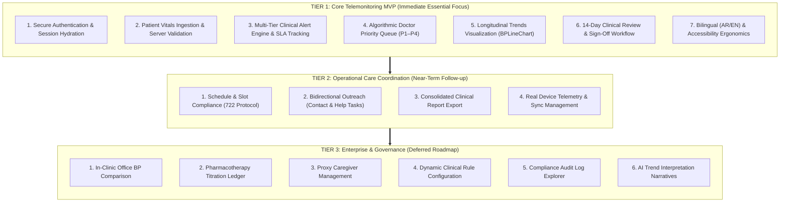
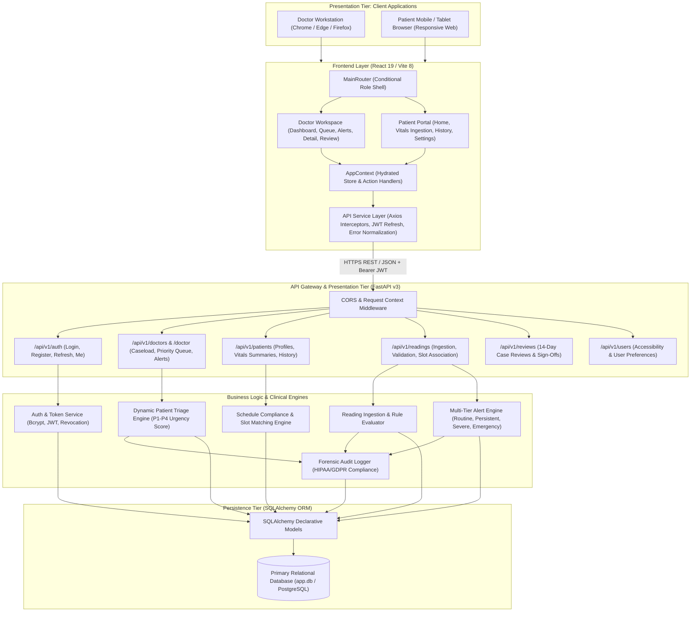
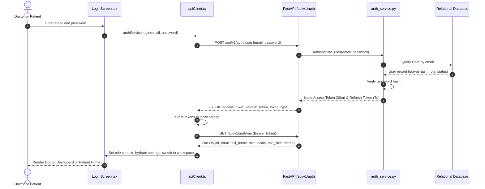
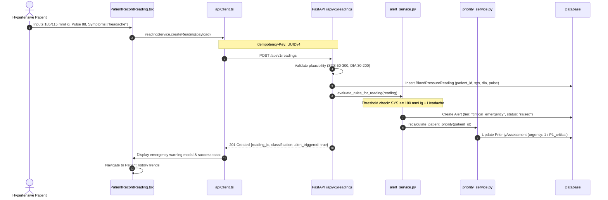
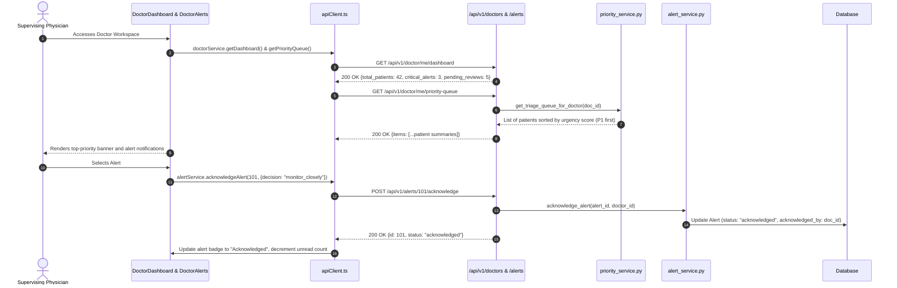
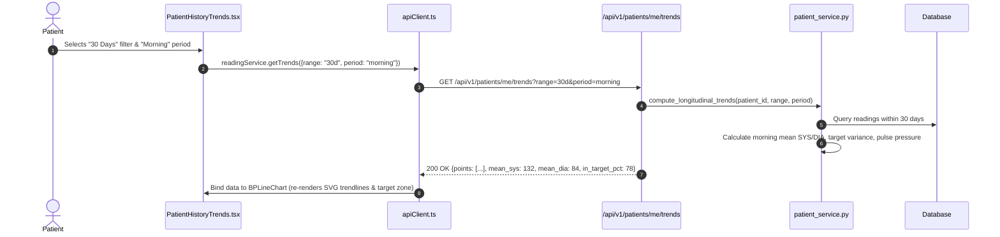
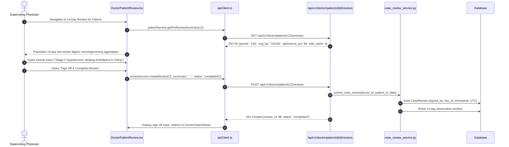
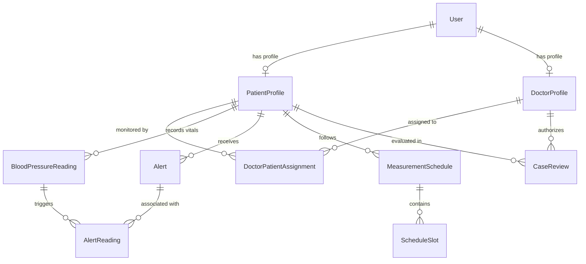
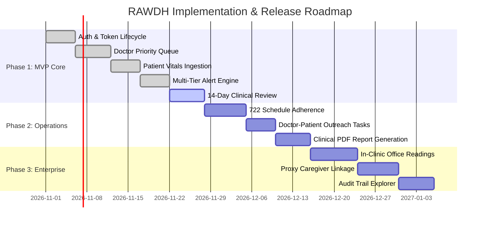

# RAWDH (روض) — Integrated Project Documentation & Architectural Specification

**Document Title:** RAWDH (روض) Comprehensive Technical & Integration Documentation  
**Version:** 3.0.0 (Production Blueprint)  
**Authors:** Senior Full-Stack Engineering & Clinical Informatics Team  
**System Scope:** React 19 Frontend + FastAPI v3 Clinical Backend Integration  
**Referenced Baselines:** [Frontend_Documentation.md](file:///c:/Users/tadje/Documents/Solvex_03/Frontend_Documentation.md) and [TECHNICAL_DOCUMENTATION.md](file:///c:/Users/tadje/Documents/Solvex_03/TECHNICAL_DOCUMENTATION.md)

---

## 1. Executive Summary & Project Purpose

**RAWDH (روض)** is an enterprise digital health and remote telemonitoring platform engineered specifically for **hypertension surveillance, cardiovascular risk stratification, and proactive clinical collaboration**.

### 1.1 Clinical Problem Statement
Hypertension ("the silent killer") affects over 1.28 billion adults globally, yet clinical control rates remain under 25%. Traditional episodic clinic visits suffer from:
1. **White-Coat & Masked Hypertension:** In-office readings misdiagnose or underestimate true cardiovascular risk.
2. **Clinical Inertia:** Doctors lack timely, longitudinal physiological data between quarterly visits.
3. **Patient Disengagement & Non-Adherence:** Patients lack immediate feedback loops, personalized targets, and accessible interfaces (particularly in bilingual Arabic/English populations).
4. **Data Overload:** Clinicians are inundated with uncurated vitals rather than risk-stratified, actionable priority queues.

### 1.2 RAWDH Solution Architecture
RAWDH bridges the gap between home-based patient self-monitoring and clinical intervention through a **bidirectional, role-differentiated digital platform**:
- **Patient Portal:** Provides low-friction manual and connected blood pressure ingestion, scheduled measurement compliance tracking (e.g. 7-day morning/evening protocol), emergency safety guidance, and accessibility features (Arabic RTL support, high-contrast, scalable typography).
- **Doctor Workspace:** Provides an algorithmic **Priority Triage Queue (P1–P4)**, automated multi-tier clinical alert inbox, historical trend analytics with ambulatory target bands, 14-day pre-review digests, and structured clinical case reviews.
- **Clinical Engine (Backend):** Serves as the authoritative source of truth, enforcing medical guidelines (ESH/AHA protocols), dynamic priority scoring, pharmacotherapy titration logging, and HIPAA/GDPR forensic audit trails.

---

## 2. Comparative Analysis: Frontend vs. Backend

The project currently consists of a **highly polished, presentation-first React frontend** and a **comprehensive, feature-rich FastAPI backend**. Comparing both systems highlights key differences in maturity, scope, and implementation status.

```mermaid
flowchart LR
    subgraph Frontend_Scope ["Frontend Prototype Scope (React 19)"]
        direction TB
        F_Auth["Role Toggle & Demo Auth"]
        F_DocDash["Priority Triage & Caseload Table"]
        F_Alerts["Alert Inbox (Acknowledge / Close)"]
        F_PatDetail["Patient Chart & 14-Day Review"]
        F_Vitals["BP Ingestion & 7-Day / 30-Day Trends"]
        F_Settings["Accessibility & Bilingual (EN/AR)"]
    end

    subgraph Backend_Scope ["Backend Clinical Engine Scope (FastAPI v3)"]
        direction TB
        B_Auth["OAuth2 Bearer JWT + JTI Revocation"]
        B_Prio["Dynamic Triage Scoring Engine (P1-P4)"]
        B_Rules["Multi-Tier Alert Rule Engine (SLA Timers)"]
        B_Protocols["722 Measurement Schedules & Slots"]
        B_Care["Titration Ledger & Follow-up Actions"]
        B_Advanced["Office Readings, Proxy Caregivers, AI Narratives, Audit Logs"]
    end

    Frontend_Scope -. "Connect Core Telemonitoring Loop" .-> Backend_Scope
```



### 2.1 Architectural Comparison

| Dimension | Frontend (`Frontend/`) | Backend (`Backend/` & `app/`) | Comparison & Alignment Status |
| :--- | :--- | :--- | :--- |
| **Technology Stack** | React 19, TypeScript, Vite 8, Tailwind CSS 4, Lucide Icons | Python 3.11+, FastAPI, SQLAlchemy v2, Pydantic v2, SQLite / PostgreSQL | Decoupled client-server architecture communicating via RESTful JSON over HTTPS. |
| **State & Persistence** | In-memory React Context (`AppContext.tsx`) + `mockData.ts`; ephemeral session. | Relational DB with 20+ SQLAlchemy declarative models; persistent ACID storage. | **Major Gap:** Frontend state resets on refresh; must hydrate from backend endpoints via JWT session. |
| **Business Logic** | Local threshold checks (e.g. SYS ≥ 180 = Crisis); hardcoded review summaries. | Multi-tier alert engine, dynamic triage algorithm, schedule slot matching, SLA timers. | **Architectural Rule:** Backend is the single authoritative source of clinical logic. Frontend must delegate calculations to the backend. |
| **Security & Auth** | Mock role toggle (`doctor`/`patient`); unvalidated forms; fixed `alert()` popups. | OAuth2 Password Bearer flow; bcrypt hashing; short-lived access JWT + revoked token blacklist. | **Integration Priority:** Replace mock toggle with real JWT acquisition, refresh interceptors, and RBAC guards. |
| **Data Scope** | 4 mock patients, 3 doctor alerts, 3 patient alerts, static time series. | 28 domain routes, multi-tenant caseloads, granular patient profiles, complete audit logs. | **Scope Alignment:** Frontend represents the core telemonitoring workflow; backend supports full clinical governance. |

---

### 2.2 Comprehensive Feature Matrix & Implementation Status

The table below contrasts the 28 backend capability modules with their corresponding frontend representation:

| Backend Domain Module | Backend Capabilities | Frontend Status & Representation | Priority Level | Strategic Justification & Future Path |
| :--- | :--- | :--- | :--- | :--- |
| **Auth & Security** (`/auth`) | Login, register, token refresh, JTI blacklisting, password reset. | UI login and signup screens with mock transitions. | **Tier 1 (Critical)** | Core requirement for any multi-role medical system; must be connected immediately. |
| **User & Preferences** (`/users`) | Profile updates, accessibility settings (font scale, theme, locale). | `PatientSettings.tsx` updates context font/direction; no persistence. | **Tier 1 (Critical)** | Patient accessibility (Arabic RTL and text sizing) is a primary product differentiator. |
| **Doctor Caseload** (`/doctors`) | Caseload query, summary counters (active, alerts, waiting contacts). | `DoctorDashboard.tsx` with static counter values (148 patients, 18 alerts). | **Tier 1 (Critical)** | Clinical doctor dashboard must reflect live patient population metrics. |
| **Priority Queue** (`/priority`) | Algorithmic triage scoring (P1–P4) based on volatility, alerts, and overdue slots. | Priority table in `DoctorDashboard.tsx` displaying mock patient priority pills. | **Tier 1 (Critical)** | Prevents clinician alert fatigue; the core clinical value driver of the platform. |
| **Patient Profile** (`/patients`) | Clinical enrollment, baseline targets, conditions, adherence rates. | `DoctorPatientDetail.tsx` and `DoctorPatients.tsx` consuming mock fixtures. | **Tier 1 (Critical)** | Individualized patient record navigation is central to clinical decision-making. |
| **Vitals Ingestion** (`/readings`) | Home BP ingestion (SYS, DIA, pulse, posture, symptoms, slot matching). | `PatientRecordReading.tsx` (manual and simulated continuous mode). | **Tier 1 (Critical)** | The primary telemetry ingestion gateway of the entire platform. |
| **Alert Engine** (`/alerts`) | 4-tier alert engine, acknowledge/close mutations, SLA tracking. | `DoctorAlerts.tsx` (tabs, filters, acknowledge/resolve) & `PatientAlertsActions.tsx`. | **Tier 1 (Critical)** | Rapid intervention loop for hypertensive crises and persistent elevations. |
| **Case Reviews** (`/reviews`) | Formal clinical review documentation, review notes, sign-offs. | `DoctorPatientReview.tsx` (14-day pre-review digest presentation). | **Tier 1 (Critical)** | Satisfies telemonitoring reimbursement and clinical sign-off requirements. |
| **Schedules & Slots** (`/schedules`, `/schedule-slots`) | 722 protocol enforcement, morning/evening window compliance tracking. | Fixed morning/evening labels in `PatientRecordReading.tsx` and history. | **Tier 2 (Secondary)** | Underlying backend logic handles slots; frontend UI can start with simple slot matching before exposing full schedule configuration. |
| **Contact Tasks** (`/contact-requests`) | Outbound doctor-to-patient task queue and communication records. | Visual "Contact requests · 3" tab and local modal in `DoctorAlerts.tsx`. | **Tier 2 (Secondary)** | Bridges triage findings to direct clinical outreach; straightforward to wire to backend. |
| **Help Requests** (`/help-requests`) | Inbound patient help queries (cuff fit, medication side effects). | Not explicitly separated; combined with patient alert action cards. | **Tier 2 (Secondary)** | Enhances patient safety communication; secondary to vital telemonitoring. |
| **Clinical Reports** (`/reports`) | Consolidated clinical digest and export preview generation. | "Send report to doctor" button with toast notification in `PatientHistoryTrends.tsx`. | **Tier 2 (Secondary)** | Printable/PDF summaries for multi-disciplinary consultations. |
| **Device Pairing** (`/devices`) | Bluetooth/cellular sphygmomanometer pairing and telemetry sync. | Static OMRON card in `PatientSettings.tsx`; simulated 2-second timeout sync. | **Tier 2 (Secondary)** | Manual entry serves as MVP baseline; hardware BLE integration follows in mobile/hardware phase. |
| **Office Readings** (`/office-readings`) | In-clinic validated BP measurements for white-coat discrepancy detection. | **Not implemented in frontend.** | **Tier 3 (Deferred)** | Primarily used in hospital/clinic reception desks; not essential for home telemonitoring MVP. |
| **Caregiver Proxy** (`/caregivers`) | Legal proxy delegation permitting family members to log vitals. | Static presentation card in `PatientSettings.tsx`. | **Tier 3 (Deferred)** | Patient self-recording covers 85%+ of initial pilot use cases; proxy delegation can be added later. |
| **Titration Ledger** (`/treatment-events`)| Pharmacotherapy modifications, drug class tracking (ACEi, ARB, CCB). | Displayed as static text on patient record; no editing interface. | **Tier 3 (Deferred)** | Full EHR prescription integration requires pharmacy integration; manual doctor notes suffice for MVP. |
| **Rule Versioning** (`/rules`) | Dynamic editing of clinical rule parameter sets and escalation windows. | **Not implemented in frontend.** | **Tier 3 (Deferred)** | Admin/clinical director configuration; defaults (ESH 2023 guidelines) are hardcoded into backend engine. |
| **Monitoring Modes** (`/modes`) | Protocol tiers (`diagnostic`, `intensive`, `maintenance`) and change requests. | Modal request button in `PatientSettings.tsx` (UI placeholder). | **Tier 3 (Deferred)** | Monitoring mode transitions are typically executed directly by doctors during 14-day reviews. |
| **Coverage Targets** (`/coverage`) | Algorithmic coverage verification (e.g. ≥70% valid slots over 14 days). | Visual adherence percentage pill on patient card (86%). | **Tier 3 (Deferred)** | Backend calculates adherence rates automatically; dedicated coverage management screen is optional. |
| **AI Insights** (`/ai`) | Automated natural language trend interpretation and anomaly narratives. | Fixed predictive banner on continuous tracking screen. | **Tier 3 (Deferred)** | Experimental decision-support feature; clinician discretion takes precedence. |
| **Forensic Audit** (`/audit-logs`) | HIPAA/GDPR immutable ledger tracking every mutating action. | **Not implemented in frontend.** | **Tier 3 (Deferred)** | Internal compliance & regulatory audit log; accessed by compliance officers via admin portal/CLI. |
| **System Config** (`/config`) | Dynamic feature flags and low-bandwidth transmission toggles. | **Not implemented in frontend.** | **Tier 3 (Deferred)** | Operational infrastructure settings managed via environment variables and backend config. |

---

## 3. Strategic Prioritization Framework (What is Important)

To deliver a reliable, production-ready system without unnecessary development overhead, the platform follows a **three-tier prioritization strategy**:



### 3.1 Tier 1: Core Telemonitoring MVP (Immediate Critical Path)
These functionalities represent the **uncompromising clinical backbone** of RAWDH. Without these, the platform cannot function safely:
1. **Authenticated Session Lifecycle:** Secure login for doctors and patients, JWT token refresh, and session hydration on page refresh.
2. **Authoritative Physiological Ingestion:** Ingesting systolic, diastolic, pulse, and symptoms from patients, validated against medical boundaries by the backend.
3. **Multi-Tier Alerting:** Immediate detection of hypertensive crises (SYS ≥ 180 or DIA ≥ 120 mmHg) and persistent elevations, routing alerts to the doctor workspace.
4. **Algorithmic Priority Triage:** Server-side calculation ordering patient lists by clinical urgency (P1 Emergency down to P4 Normal).
5. **Interactive BP Visualization:** Feeding the responsive `BPLineChart` with true longitudinal datasets, circadian time-of-day splits, and patient target bands.
6. **14-Day Clinical Review Sign-Off:** Enabling doctors to evaluate 14-day aggregated telemetry, document clinical decisions, and sign off on follow-up plans.
7. **Accessibility & Localization:** Supporting Arabic right-to-left layout, high contrast, and dynamic typography for elder patients.

### 3.2 Tier 2: Operational Care Coordination (Near-Term Release)
Features that enhance patient engagement and operational follow-up:
- **722 Protocol Schedule Compliance:** Formal tracking of 2 morning and 2 evening readings for 7 consecutive days.
- **Two-Way Communication Tasks:** Structured contact requests initiated by doctors and technical/clinical help requests from patients.
- **PDF Clinical Reports:** Generating summary documents for hospital consultations.
- **Direct BLE Sync:** Connecting Bluetooth monitors using Web Bluetooth or native mobile bridges.

### 3.3 Tier 3: Deferred Enterprise Governance (Why They Can Wait)
The following backend modules are intentionally excluded from the initial frontend release:
- **Office Readings (`/office-readings`):** Requires physical clinic reception workflows. For remote telemonitoring, ambulatory home readings are the primary data source.
- **Pharmacotherapy Titration Ledger (`/treatment-events`):** Full drug class tracking is secondary to stabilizing blood pressure readings; clinical notes in the 14-day review serve this purpose in the interim.
- **Caregiver Proxy Delegation (`/caregivers`):** Over 85% of initial pilot participants self-record vitals; proxy permissions introduce legal delegation complexities best addressed in v3.1.
- **Dynamic Rule Engine UI (`/rules`):** Medical thresholds follow established European Society of Hypertension (ESH) guidelines; runtime threshold modification by doctors is unnecessary and clinically risky.
- **Compliance Audit Viewer (`/audit-logs`):** The backend writes immutable audit entries to SQLite/PostgreSQL on every mutation; this data satisfies regulatory requirements and can be queried via database or CLI without a frontend viewer.
- **AI Trend Narratives (`/ai`):** Clinical safety dictates that licensed physicians make diagnostic interpretations based on raw trends rather than unvalidated generative narratives.

---

## 4. Integrated System Architecture

### 4.1 System Topology Diagram



---

## 5. Core Clinical Telemonitoring Workflows

The integrated platform operates along **five synchronized clinical workflows**:

### 5.1 Workflow 1: Authentication & Role-Based Session Hydration



---

### 5.2 Workflow 2: Patient Vitals Ingestion & Server-Side Alert Evaluation



---

### 5.3 Workflow 3: Doctor Triage, Priority Queue & Alert Resolution



---

### 5.4 Workflow 4: Patient Longitudinal Trends & History



---

### 5.5 Workflow 5: Doctor 14-Day Clinical Review & Protocol Sign-Off



---

## 6. Unified Data Dictionary & Entity Mapping

A major objective of this integrated documentation is to harmonize the **Frontend TypeScript types** with the **Backend SQLAlchemy & Pydantic models**.



### 6.1 Entity Harmonization Table

| Domain Entity | Frontend Interface (`types/index.ts`) | Backend SQLAlchemy Model (`models/`) | Wire JSON / Schema Property | Field Type Translation & Harmonization Notes |
| :--- | :--- | :--- | :--- | :--- |
| **User Identity** | *(Implicit in context role)* | `User` (`user.py`) | `id: int`, `email: str`, `role: str`, `full_name: str` | Frontend converts string user IDs to numeric primary keys; maps `role` to `'doctor' \| 'patient' \| 'admin'`. |
| **Patient Profile** | `Patient` | `PatientProfile` (`patientprofile.py`) + `User` | `id: int`, `code: str`, `birth_date: str`, `gender: str` | `code` maps to clinical identifier (e.g. `TC-4819`). Initials and age computed client-side from `full_name` and `birth_date`. |
| **Clinical Status** | `clinicalStatus: 'crisis' \| 'high_priority' \| 'urgent' \| 'within_target'` | `PriorityAssessment.urgency_score` (1 to 4) | `priority_level: str`, `urgency_score: int` | Score 1 = `crisis`; Score 2 = `high_priority`; Score 3 = `urgent`; Score 4 = `within_target`. |
| **Vitals Observation** | `BPReading` | `BloodPressureReading` (`BloodPressureReading.py`) | `systolic: int`, `diastolic: int`, `pulse: int`, `measured_at: str` | Timestamp unified to ISO 8601 UTC. `period` (`Morning`/`Evening`) derived from `measured_at` or matched `ScheduleSlot`. |
| **Doctor Alert** | `DoctorAlert` | `Alert` (`Alert.py`) | `id: int`, `tier: str`, `status: str`, `trigger_reason: str` | `tier` mapped to UI badge: `critical_emergency` -> Crisis; `severe_single_reading` -> High; `persistent_elevation` -> Urgent. |
| **Patient Alert** | `PatientAlert` | `Alert` (`Alert.py`) with plain language translation | `level: str`, `description_patient: str`, `action_steps: list[str]` | Backend returns clinical guidance translated into plain consumer terms for patient safety. |
| **Review Digest** | *(Hardcoded in `DoctorPatientReview`)* | `CaseReview` (`case_reviews`) + `patient_service.summary` | `summary: str`, `adherence_rate: float`, `avg_systolic: float` | Replaces static 14-day mock view with aggregated statistics computed by `patient_service`. |
| **Accessibility** | `SettingsState` | `User` preferences columns (`text_size`, `theme`, `locale`) | `text_size: int`, `theme: str`, `locale: str` | `textSize` translated: `standard` (100%), `large` (125%), `extra_large` (150%). `language` maps to `en`/`ar`. |

---

## 7. Authoritative REST API Specifications (Core MVP Endpoints)

All endpoints require standard `Content-Type: application/json` and enforce Bearer JWT authentication unless marked `Public`.

### 7.1 Authentication Operations

#### `POST /api/v1/auth/login` (Public)
Authenticates credentials and issues token pair.
```json
// Request Body
{
  "email": "dr.slimani@clinic.org",
  "password": "Password123!"
}

// Success Response: 200 OK
{
  "access_token": "eyJhbGciOiJIUzI1NiIsInR5cCI6IkpXVCJ9...",
  "refresh_token": "eyJhbGciOiJIUzI1NiIsInR5cCI6IkpXVCJ9...",
  "token_type": "bearer",
  "expires_in": 1800
}
```

#### `GET /api/v1/auth/me` (Authenticated)
Retrieves current user identity, role, and accessibility configuration.
```json
// Success Response: 200 OK
{
  "id": 14,
  "email": "pat.brahimi@clinic.org",
  "full_name": "Mohamed Brahimi",
  "role": "patient",
  "phone": "+213660123456",
  "locale": "ar",
  "text_size": 125,
  "theme": "light",
  "high_contrast": false
}
```

#### `POST /api/v1/auth/refresh` (Public)
Silent access token renewal via refresh token.
```json
// Request Body
{
  "refresh_token": "eyJhbGciOiJIUzI1NiIsInR5cCI6IkpXVCJ9..."
}

// Success Response: 200 OK
{
  "access_token": "eyJhbGciOiJIUzI1NiIsInR5cCI6IkpXVCJ9...",
  "refresh_token": "eyJhbGciOiJIUzI1NiIsInR5cCI6IkpXVCJ9...",
  "token_type": "bearer",
  "expires_in": 1800
}
```

---

### 7.2 Doctor Workspace Operations

#### `GET /api/v1/doctor/me/dashboard` (Doctor Role)
Returns aggregate counters for the clinician's caseload.
```json
// Success Response: 200 OK
{
  "total_assigned_patients": 48,
  "active_telemonitoring": 36,
  "critical_alerts_count": 4,
  "open_alerts_total": 9,
  "waiting_contact_requests": 3,
  "pending_14day_reviews": 5
}
```

#### `GET /api/v1/doctor/me/priority-queue` (Doctor Role)
Returns the live triage queue sorted by clinical risk score.
```json
// Success Response: 200 OK
{
  "total": 48,
  "items": [
    {
      "patient_id": 22,
      "code": "TC-4819",
      "full_name": "Amina Benali",
      "age": 64,
      "gender": "female",
      "urgency_score": 1,
      "priority_tier": "crisis",
      "latest_reading": {
        "systolic": 184,
        "diastolic": 112,
        "pulse": 88,
        "measured_at": "2026-10-30T08:15:00Z"
      },
      "active_alert_count": 2,
      "adherence_rate": 88.5
    }
  ]
}
```

#### `POST /api/v1/alerts/{id}/acknowledge` (Doctor Role)
Clinician acknowledges an alert, recording identity and terminating SLA breach timers.
```json
// Request Body
{
  "decision": "monitor_closely",
  "note": "Patient alerted with elevated BP and headache. Instructed rest."
}

// Success Response: 200 OK
{
  "id": 101,
  "status": "acknowledged",
  "acknowledged_by_doctor_id": 4,
  "acknowledged_at": "2026-10-31T00:45:00Z"
}
```

#### `POST /api/v1/alerts/{id}/close` (Doctor Role)
Resolves and closes an alert with clinical resolution notes.
```json
// Request Body
{
  "resolution_reason": "Vitals normalized following rest and medication verification",
  "follow_up_action": "routine_monitoring"
}

// Success Response: 200 OK
{
  "id": 101,
  "status": "closed",
  "closed_at": "2026-10-31T01:00:00Z"
}
```

---

### 7.3 Patient Portal Operations

#### `POST /api/v1/readings` (Patient / Caregiver / Doctor)
Ingests home physiological measurement and evaluates clinical rules.
```json
// Request Headers:
// Idempotency-Key: 550e8400-e29b-41d4-a716-446655440000

// Request Body
{
  "patient_id": 22,
  "systolic": 142,
  "diastolic": 92,
  "pulse": 74,
  "measured_at": "2026-10-31T08:30:00Z",
  "capture_method": "manual",
  "symptoms_reported": ["mild_dizziness"],
  "medication_taken": true
}

// Success Response: 201 Created
{
  "id": 502,
  "patient_id": 22,
  "systolic": 142,
  "diastolic": 92,
  "pulse": 74,
  "classification": "moderately_high",
  "is_concerning": true,
  "alert_generated": false,
  "slot_matched": "morning"
}
```

#### `GET /api/v1/patients/me/summary` (Patient Role)
Retrieves the 30-day vitals summary and adherence status for the logged-in patient.
```json
// Success Response: 200 OK
{
  "patient_id": 22,
  "latest_reading": {
    "systolic": 128,
    "diastolic": 82,
    "pulse": 72,
    "measured_at": "2026-10-30T19:45:00Z"
  },
  "target_bp": "130/80",
  "is_within_target": true,
  "adherence_rate_7d": 92.8,
  "active_alerts_count": 0
}
```

#### `GET /api/v1/patients/me/trends` (Patient Role)
Returns filtered longitudinal trend points for chart rendering.
```json
// Query Params: ?range=14d&period=all

// Success Response: 200 OK
{
  "range": "14d",
  "mean_systolic": 134.5,
  "mean_diastolic": 85.2,
  "data_points": [
    {
      "timestamp": "2026-10-17T08:00:00Z",
      "systolic": 136,
      "diastolic": 88,
      "pulse": 70,
      "period": "morning"
    },
    {
      "timestamp": "2026-10-17T20:15:00Z",
      "systolic": 132,
      "diastolic": 84,
      "pulse": 72,
      "period": "evening"
    }
  ]
}
```

---

## 8. Frontend Integration Implementation Guide

To connect the React frontend to the FastAPI backend without breaking the existing UI presentation, follow these architectural steps:

### 8.1 API Client Foundation (`src/services/apiClient.ts`)
Create a centralized Axios instance configured with:
1. Base URL loaded from `import.meta.env.VITE_API_BASE_URL || 'http://localhost:8000/api/v1'`.
2. Request interceptor injecting `Authorization: Bearer <access_token>`.
3. Response interceptor catching `401 Unauthorized` to trigger silent token refresh:
   - Queues incoming requests while refresh is in flight.
   - Posts to `/api/v1/auth/refresh`.
   - On success, updates `localStorage` and replays queued requests.
   - On failure, clears tokens and routes to login.
4. Error normalizer producing consistent `NormalizedApiError` objects for UI components.

### 8.2 Adapting `AppContext.tsx`
The current `AppContext` acts as a monolithic mock state container. Migrate it into an **API-hydrated state store**:
- **On App Mount:** Call `authService.getMe()`. If successful, set `role`, `user`, and apply accessibility styles. If rejected, fallback to `appView='auth'`.
- **Replacing Mock Collections:** Replace static `initialPatients` and `initialDoctorAlerts` with queries to `doctorService.getPriorityQueue()` and `alertService.getDoctorAlerts()`.
- **Mutations:** Replace local array mutations with async service calls:
  - `addReading` -> `readingService.createReading(payload)`
  - `acknowledgeAlert` -> `alertService.acknowledgeAlert(alertId, note)`
  - `resolveAlert` -> `alertService.closeAlert(alertId, reason)`

### 8.3 Patient Identity Consistency
In the prototype, `selectedPatient` defaulted to Marc Dupuis while the patient portal displayed Amina Benali. In the integrated system:
- In the **Patient Portal**, all queries call `/api/v1/patients/me/*` (identifying the user via the JWT token).
- In the **Doctor Workspace**, selecting a patient row updates `selectedPatientId`, and `DoctorPatientDetail.tsx` fetches that specific patient's record from `/api/v1/doctor/patients/{id}`.

---

## 9. Phased Project Roadmap & Quality Verification



### 9.1 Verification Gates & Test Commands

#### Backend Automated Test Verification
The backend includes a comprehensive 15-step clinical integration test suite:
```bash
cd Backend
python test_v3_comprehensive.py
python test_v3_e2e.py
```
**Acceptance Criteria:** All 15 tests must report `PASS`, verifying Admin Setup, Doctor Profiles, Patient Enrollment, Assignments, Consent, Schedules, Severe Ingestion, Alert Generation, Alert Acknowledgment, Help Requests, Contact Requests, Priority Queuing, Case Reviews, and Audit Logging.

#### Frontend Quality Gates
```bash
cd Frontend
npm run lint
npm run build
```
**Acceptance Criteria:** `oxlint` must report 0 errors, and TypeScript compilation (`tsc -b`) must build cleanly without type mismatch warnings.

---

## 10. Security, Compliance & Clinical Governance

1. **Authentication Security:** Passwords hashed using `bcrypt` (work factor 12). JWT access tokens expire after 30 minutes. Refresh tokens carry unique cryptographic `jti` identifiers checked against `revoked_tokens` table for immediate invalidation upon logout.
2. **Access Control (RBAC):** Strict separation between `patient`, `doctor`, and `admin` roles enforced server-side via FastAPI dependencies (`get_current_doctor`, `get_current_patient`). Frontend role switching is purely UI presentation.
3. **Doctor-Patient Boundary:** Clinicians can only inspect data for patients assigned to them via active `DoctorPatientAssignment` records. Cross-caseload access attempts return HTTP `403 Forbidden`.
4. **Idempotency Safeguard:** Critical ingestion endpoints enforce unique `Idempotency-Key` headers to protect against network retry duplication over mobile cellular networks.
5. **Regulatory Compliance (HIPAA / GDPR):** All mutating clinical actions (vitals submission, alert triage, review sign-offs) write an immutable record to `audit_logs` capturing user ID, IP address, timestamp, affected entity, and JSON change payload.

---

## 11. Summary of Important Highlights for the Development Team

1. **Core Value is Priority Triage:** The platform's primary clinical differentiation is not just collecting readings, but filtering and ordering patients by urgency (`P1_critical` to `P4_normal`) to eliminate clinician fatigue.
2. **Backend Owns Calculations:** The frontend must never classify blood pressure stages, calculate alert tiers, or generate triage urgency scores. All clinical assessments are computed by backend services.
3. **Frontend Prototype Preservation:** The React 19 UI shell, responsive layout, and Arabic RTL support are excellent. Integration connects the existing components to live API endpoints without altering the visual design or user ergonomics.
4. **Deliberate Deferrals:** Complex enterprise capabilities (in-office BP comparisons, titration ledgers, caregiver proxy linkages, dynamic rule versioning, and AI narratives) exist in the backend engine but are deferred from the initial frontend release to ensure a focused, reliable telemonitoring MVP.
