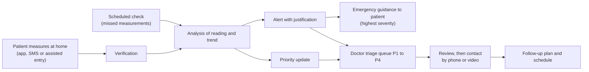

# RAWDH (روض): Project Description

> Remote hypertension monitoring and doctor triage, designed for Algeria.
> Built for SolveX 3.0, Problématique 2: *Hypertension, early detection and continuous follow-up.*

---

## 1. At a glance

| | |
|---|---|
| **Pitch** | A lightweight platform that connects a patient's daily home blood-pressure readings to their doctor. The system checks every reading, flags worrying values and trends, and shows the doctor first the patients who need attention, so nobody is lost between two consultations. |
| **Users** | Patients with hypertension (and the relatives who help them), doctors and cardiologists, clinics and institutions |
| **Core principle** | Decision support, not diagnosis. The system flags and explains; the doctor decides. |
| **Delivery** | Patient portal and doctor workspace on a web platform, built for low-connectivity use |
| **Launch budget** | Lean MVP under 2 million DZD, including hardware and AI (team estimate) |

---

## 2. The problem

### 2.1 A silent disease and a blind interval

Hypertension is often silent, and follow-up relies on blood pressure measured during consultations. Between two visits, the doctor has almost no visibility on how the patient's pressure evolves. Deterioration goes unnoticed, and a single office reading can mislead.

### 2.2 What the SolveX brief asks us to solve

1. **Discontinuous monitoring:** the patient sees the doctor at two separate moments, and the period in between is invisible.
2. **A silent condition:** anomalies are not flagged, so the patient goes untreated.
3. **Identifying when medical intervention is needed.**

### 2.3 Our five problems

| # | Problem | Consequence |
|---|---|---|
| P1 | No traceability between consultations | The doctor's judgement relies on isolated values |
| P2 | Unusual measures are not flagged | Deterioration is found late |
| P3 | Situations needing intervention are not identified | Urgent cases look like stable ones |
| P4 | Patients are not ranked by priority | Urgent patients are buried among stable ones |
| P5 | Doctors spend too long reading and summarising data | Time goes to data reading instead of decisions |

### 2.4 Why it matters in Algeria

- The brief reports about **7.7 million** people concerned, with about **6.4 million** uncontrolled (figures from the organizers; primary source to be confirmed).
- An Algerian national survey found that **about half** of hypertensive adults were unaware of their condition.
- An Algerian ambulatory-monitoring study found that office readings alone missed cases that led to starting or changing treatment.
- Algeria has **no dedicated national hypertension guideline**; clinicians rely on international guidance (ISH, ESC/ESH). Any digital tool must therefore keep its clinical rules visible, versioned and approved by clinicians.
- Validated home monitors are not widely owned across Africa, and digital access varies by age and region. The solution must work on simple devices and weak networks.

---

## 3. The solution

### 3.1 Concept

RAWDH is a two-sided platform built around one entry point, the **measurement**.

- **Patient side:** record a reading, follow the history and trend, receive reminders, ask for help, and get clear guidance in plain language.
- **Doctor side:** every reading is verified and analysed automatically; the doctor receives justified alerts, a priority-sorted patient list, a ready-made pre-review summary, and tools to review and contact patients.

### 3.2 How it works

1. **Measure.** The patient follows a standard home protocol (the *722* protocol: two readings in the morning and two in the evening for seven days) and records each reading.
2. **Verify.** Impossible values are rejected; unusual but possible values are confirmed and still analysed, so a real emergency is never blocked.
3. **Analyse.** The engine evaluates the reading and the trend against rules that are versioned and approved by clinicians. A scheduled check also detects **missing** readings, because silence is itself a signal.
4. **Alert.** Alerts are tiered (routine, persistent, severe, emergency) and always carry their justification: which readings or trend triggered them, and why.
5. **Triage.** Patients are ordered P1 to P4 with the reasons shown, so the doctor starts with who needs attention first.
6. **Act.** The doctor reviews a 14-day summary, signs off, records the action taken, and contacts the patient if needed.

### 3.3 Two monitoring modes, one engine

| | Self-monitoring | Telemonitoring |
|---|---|---|
| Who follows the data | The patient, supported by the app | The doctor or care team, between visits |
| Alerts | Shown to the patient; visible to the doctor; doctor actively notified at higher levels | Actively routed to the doctor workspace |
| Schedule | Recommended protocol, adjustable by the patient | Defined or approved by the doctor |
| Typical use | Stable or low-risk patients | Uncontrolled or high-risk patients |

The analysis is identical in both modes; only responsibility and routing change. A doctor can move a patient from one mode to the other.

### 3.4 What each capability solves

| Problem | Capabilities |
|---|---|
| P1 Traceability | Reading capture, history, trend chart, schedule and reminders, adherence tracking |
| P2 Flagging | Verification, detection of concerning readings, trend analysis, justified alerts |
| P3 Intervention | Alert tiers, emergency guidance, help and contact requests, review status |
| P4 Ranking | Priority classification P1 to P4, sorted list, filters, reasons shown |
| P5 Doctor time | Pre-review summary (14 days), period report, trend-first dashboard |

### 3.5 Safety and trust by design

- **Decision support, not diagnosis.** The doctor stays responsible for every medical decision.
- **Explainable.** Every alert and every priority level shows why it was produced.
- **Emergency first.** At the highest severity, the patient receives guidance immediately and does not wait for a doctor's review. Emergency instructions are written and approved by clinicians.
- **Clinician-validated rules.** Thresholds are not decided by developers. They are stored as versioned parameters and approved before activation.
- **Security and privacy.** Role-based access, doctors see only their assigned patients, authentication with token revocation, an audit trail of changes, and patient consent for data sharing. Compliance with the applicable Algerian data-protection law is to be verified.

### 3.6 Status (as documented on 31 October 2026; update before judging)

| Component | Status |
|---|---|
| Backend clinical engine (FastAPI): authentication, reading ingestion with validation and idempotency, tiered alert engine, priority triage, schedules, case reviews, contact and help requests, audit trail | Implemented; 15-step integration test suite |
| Frontend (React): doctor workspace, patient portal, Arabic right-to-left layout, adjustable text size, high-contrast mode | Prototype; connection to the live backend in progress |
| SMS, phone and video, low-bandwidth mode, personalized recommendations, load balancing | Planned (section 8) |

---

## 4. Built for Algeria

| Need | How RAWDH responds | Status |
|---|---|---|
| **Arabic** | Right-to-left interface, large text and high-contrast options for older patients | Available |
| **SMS** | Patients without a smartphone or data plan send readings and receive reminders and guidance by text message, with no personal data in message bodies | Planned |
| **Phone and video calls** | The doctor turns a contact request into a phone call or a video consultation; audio-first when bandwidth is poor | Planned |
| **Low bandwidth** | Light pages, compact data, offline entry that syncs later, safe resend of readings | Partly in place (safe resend); rest planned |
| **Affordable and flexible pricing** | Bring your own validated cuff, device leasing, institutional bulk pricing, a modest doctor subscription | See section 7 |
| **No hospital IT dependency** | Works without electronic medical records or hospital integration | Available |
| **Local clinical authority** | Rules versioned and approved by Algerian clinicians, since no national guideline exists | Design principle |

---

## 5. Innovation

1. **Explainable triage.** Alerts and priorities always show their reasons, which keeps the doctor in control.
2. **Absence-aware monitoring.** The system detects missed readings, not only abnormal ones.
3. **Two care models on one engine.** Self-monitoring and telemonitoring share the same pipeline, so a patient can move between them without a new system.
4. **Personalized recommendations (next step).** Personalized, clinician-approved guidance from the patient's own data: measurement coaching (posture, rest, timing), reminder timing adapted to each patient, and lifestyle education tailored to their profile. It never changes treatment. Personalized, interactive reminders have outperformed fixed ones in published trials.
5. **Built for weak infrastructure.** SMS, phone, video and low-bandwidth modes extend monitoring to patients that app-only solutions miss.
6. **Responsible AI (research track).** Prediction models are developed and validated with clinicians before any output reaches a patient. Until then, the system is rule-based and explainable.

---

## 6. Feasibility and scalability

### 6.1 Technology

A web platform with a React interface and a FastAPI backend on a relational database. The clinical logic is held entirely on the server, so the interface cannot change a clinical result. The prototype relies on simple technologies and an affordable home monitor.

### 6.2 Cost

Launch budget estimate: **under 2 million DZD**, covering platform development, hardware and AI. A line-by-line breakdown will be prepared for the pitch.

### 6.3 Scalability: load balancing between doctors

- **Assignment balancing:** new patients go to the doctor with the lowest weighted load (patients plus open alerts); caseloads can be rebalanced.
- **Backup routing:** an alert not acknowledged in time is re-routed to a backup clinician, with an on-call rota for nights and weekends.
- **Nurse-first option:** routine alerts can go to a nurse or pharmacist before the doctor, which research shows keeps most alerts away from physicians.
- **Alert burden control:** a single open alert per patient and class collects new evidence instead of creating duplicates.

### 6.4 Risks and mitigation

| Risk | Mitigation |
|---|---|
| Patients stop measuring (adherence drops quickly in published programs) | Adaptive reminders, SMS, simple protocol, missed-reading detection, outreach by phone |
| Alert fatigue for doctors | Tiered alerts, single open alert per class, nurse-first routing, priority queue |
| Wrong or fabricated readings | Verification, device-memory comparison where available, pattern checks on data quality, validated devices |
| No doctor available at night | On-call rota, backup routing, and emergency guidance that does not depend on a doctor |
| Rules that are not clinically sound | Versioned rules, clinician approval, validation on synthetic scenarios, then pilot |
| Regulation of medical software | Decision-support positioning, local clinical validation at university hospitals |

---

## 7. Business model

| Block | Content |
|---|---|
| **Customer segments** | Patients with hypertension and people at cardiovascular risk; doctors and cardiologists who need continuous access to their patients' data; clinics and institutions |
| **Value for patients** | Regular, automated monitoring; early detection of concerning changes; clear guidance; less uncertainty between consultations |
| **Value for doctors** | Remote access to measurements; visibility between consultations; automatic, justified alerts; a priority list; time saved on data reading |
| **Channels** | Website and digital platforms, word of mouth between patients and trusted doctors, medical partnerships, social media, medical events and awareness campaigns |
| **Customer relationships** | Confidentiality and security, reliable measurements, personalized notifications and reports, technical support and training, transparency about limits |
| **Revenue** | One-time sale of a validated connected device (planned price 15,000 DZD per unit); doctor platform subscription (2,500 DZD per month); institutional pilot programs and bulk device leasing to clinics |
| **Pricing flexibility** | Bring your own validated cuff, device leasing or instalments, institutional bulk pricing, an SMS-only option for patients without a smartphone (options to be finalised) |
| **Key activities** | Build and maintain the platform; collect and analyse measurements; develop trends and alerts; validate accuracy with clinicians; secure the data |
| **Key partners** | Ministry of Health, doctors and cardiologists, device manufacturers and suppliers, cloud providers, investors; telecom operators for SMS (planned) |
| **Cost structure** | Platform and AI development, local medical validation at university hospitals, device import and certification, security, marketing and support |

**Device policy.** Only clinically validated devices are accepted. The reference standard is a validated upper-arm cuff; a connected ring or bracelet is offered only if it has proven clinical validation. The MVP accepts manual entry from any validated home monitor.

**Go-to-market.** Start with pilot programs in partner clinics and with a small group of doctors, measure adherence and doctor workload, then expand through medical partnerships.

---

## 8. Vision and roadmap

**Vision:** every hypertensive patient in Algeria is visible to their doctor between visits, whatever their device, network or language.

### 8.1 Roadmap

| Horizon | Focus |
|---|---|
| **Now** | Core telemonitoring loop: authentication, readings, tiered alerts, priority triage, trends, 14-day review, Arabic and accessibility |
| **Next** | Schedules and reminders, contact tasks, reports, SMS channel, phone and video, low-bandwidth mode, doctor load balancing, device sync |
| **Later** | Personalized recommendations, validated AI prediction, caregiver access, medication-change tracking, clinic and hospital integration, extension to other chronic conditions |

### 8.2 Future integrations (planned, beyond the current documentation)

| Integration | What it adds | Guardrails |
|---|---|---|
| **SMS gateway** | Send readings, receive reminders and guidance without a smartphone | Registered numbers only; no names or diagnoses in messages |
| **Phone and video consultation** | A contact request becomes a call or video session; the outcome is logged in the review | Audio-first fallback on weak networks |
| **Low-bandwidth mode** | Lightweight screens, compact data, offline entry that syncs later | Safe resend so no reading is lost or duplicated |
| **Doctor load balancing and backup routing** | Balanced caseloads, on-call coverage, escalation of unacknowledged alerts | Named owner and documented disposition for every alert |
| **Adaptive reminders and notifications** | Weekly baseline reminders, extra prompts only after a missed reading | Personalized timing chosen by the patient |
| **Personalized recommendations** | Measurement coaching and tailored education from the patient's own data | Clinician-approved content; no treatment changes; doctor can switch it off per patient |
| **Connected validated devices** | Automatic transmission over Bluetooth or cellular, no manual entry errors | Validated devices only |
| **Flexible pricing and device leasing** | Wider access for patients and clinics | Options finalised after pilot feedback |
| **French interface** | Matches the language many clinicians and patients use in Algeria | Same content, approved translations |
| **Validated AI prediction** | Earlier warning of deterioration | Developed and validated with clinicians; shown only after local validation |

**Already built in the backend, to be exposed in the interface:** caregiver access, medication-change tracking, in-clinic readings for comparison, clinical rule management, audit viewer.

---

## 9. Evidence base

| Source | What it shows |
|---|---|
| TASMINH4 (UK randomised trial, 1,182 patients) | Home monitoring, with or without SMS-based telemonitoring, lowered systolic pressure at 12 months compared with usual care (about 137.0 and 136.0 versus 140.4 mmHg) |
| Mass General Brigham remote program (USA) | Connected cuffs plus a clinical algorithm and non-physician staff lowered blood pressure; removing the need for a smartphone or Wi-Fi increased device use |
| COBRA-BPS (South Asia, cluster trial) | Community health workers with home monitoring at low estimated cost per patient |
| HOROSCOPE (Tunisia, randomised trial) | Phone-based telemonitoring with weekly calls |
| Evidence reviews we conducted | Alerts work best as tiers; adherence falls quickly without support; personalized and interactive reminders outperform fixed ones; clinician feedback and treatment adjustment drive the benefit |

*Figures are to be verified against the primary papers before they are cited in the presentation.*
