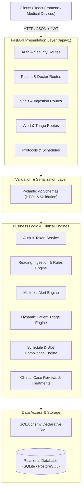

# Solvex 3.0 — Technical Solution Documentation

## 1. Executive Summary & Architecture Overview

**Solvex 3.0** is an enterprise-grade digital health and remote telemonitoring platform engineered for hypertension surveillance, cardiovascular risk stratification, and bidirectional clinical collaboration. The platform automates blood pressure ingestion, intelligent multi-tier clinical alert generation, dynamic patient priority queuing, protocol-based measurement schedules, and medication treatment event tracking.

### System Architecture Flow

The backend employs a strictly decoupled, layered architecture:



---

## 2. Data Models (Domain Entities)

All models inherit from a common `Base` (`app.db.base`) enforcing unified constraint naming conventions across indexes, foreign keys, and primary keys.

### 2.1 Identity, Users & Security
* **`User`** (`users`): Primary account entity for all platform actors (`patient`, `doctor`, `admin`). Tracks email, phone, bcrypt password hash, accessibility preferences (text size, calm dark / light theme, high contrast), and status flags.
* **`RevokedToken`** (`revoked_tokens`): Stores cryptographic JWT unique identifiers (`jti`), token types, and expiration dates for instantaneous session termination and blacklisting.

### 2.2 Profiles & Clinical Linkages
* **`PatientProfile`** (`patient_profiles`): Clinical profile storing date of birth, biological sex, emergency contact details, baseline BP targets, and enrolled status.
* **`DoctorProfile`** (`doctor_profiles`): Clinician profile storing medical license number, cardiology/general practice specialization, and clinical contact phone.
* **`DoctorPatientAssignment`** (`doctor_patient_assignments`): Association entity tracking primary and secondary physician assignments, assignment dates, and active flags.
* **`CaregiverLink`** (`caregiver_links`): Manages authorized proxy relationships allowing designated caregivers to record vitals and view summaries on behalf of patients.
* **`Consent`** (`consents`): Forensic ledger of patient digital consent versions, scopes (data sharing, telemonitoring), granted timestamps, and revocations.

### 2.3 Blood Pressure Readings & Devices
* **`BloodPressureReading`** (`blood_pressure_readings`): Core physiological observation. Records systolic (mmHg), diastolic (mmHg), pulse rate (bpm), irregular heartbeat flags, patient posture (`sitting`, `standing`, `supine`), arm used, cuff size, and ingestion source (`patient`, `device`, `caregiver`).
* **`OfficeReading`** (`office_readings`): In-clinic validated readings obtained by clinical staff for comparison against home readings to detect "white-coat" and "masked" hypertension.
* **`TargetRecord`** (`target_records`): Personalized target BP thresholds configured per patient by their supervising doctor.
* **`ConnectedDevice`** (`connected_devices`): Paired Bluetooth / cellular blood pressure monitors, manufacturer metadata, paired date, and last sync timestamps.

### 2.4 Monitoring Protocols, Schedules & Adherence
* **`MeasurementSchedule`** (`measurement_schedules`): Prescribed measurement regimens specifying start dates, end dates, active status, and protocol frequency.
* **`ScheduleSlot`** (`schedule_slots`): Time-window slots (e.g. `morning`, `evening`) with strict adherence tracking (`pending`, `completed`, `missed`, `partial`).
* **`PatientMonitoringMode`** (`patient_monitoring_modes`): Active protocol mode (`onboarding`, `diagnostic`, `intensive`, `maintenance`, `step_down`, `telemonitoring`).
* **`ModeChangeRequest`** (`mode_change_requests`): Doctor approval workflow for transitioning patient monitoring tiers.
* **`CoverageTarget`** (`coverage_targets`): Target adherence threshold (e.g. 70% completed slots over 14 days) required for clinical diagnostic validity.

### 2.5 Clinical Decision Support, Alerts & Triage
* **`Alert`** (`alerts`): Clinical alert instances triggered by vital anomalies. Supports four severity tiers:
  * `routine_out_of_range`: Mild elevation over threshold.
  * `persistent_elevation`: Consecutive elevated readings over a defined time window.
  * `severe_single_reading`: Systolic ≥ 180 or Diastolic ≥ 120 mmHg.
  * `critical_emergency`: Critical readings accompanied by symptoms.
  Alert lifecycle transitions: `raised` ➔ `delivered` ➔ `acknowledged` ➔ `escalated` ➔ `closed`.
* **`AlertReading`** (`alert_readings`): Association mapping which specific vitals triggered an alert.
* **`PriorityAssessment`** (`priority_assessments`): Dynamic priority calculation record storing triage scores (1–4 urgency levels), assessment rationale, and reassessment timestamps.
* **`RuleVersion`** (`rule_versions`): Versioned clinical rule definitions and parameter sets (thresholds, windows, escalation timers).
* **`PatientCondition`** (`patient_conditions`): Patient comorbidities (diabetes, CKD, coronary artery disease, pregnancy) influencing risk tiering.
* **`TreatmentEvent`** (`treatment_events`): Pharmacotherapy ledger tracking medication introductions, titration adjustments, discontinuations, and drug classes (ACEi, ARB, CCB, Diuretics).

### 2.6 Workflows, Communication & Governance
* **`CaseReview`** (`case_reviews`): Formal doctor clinical review records including review notes, plan adjustments, and clinical sign-offs.
* **`FollowUpAction`** (`follow_up_actions`): Action items arising from reviews (e.g. clinic visit, medication adjustment, lab order).
* **`ContactRequest`** (`contact_requests`): Outbound clinical requests initiated by doctors or care teams to patients.
* **`PatientHelpRequest`** (`patient_help_requests`): Patient-initiated help queries (adverse symptoms, cuff fit issues, prescription refills).
* **`Notification`** (`notifications`) & **`ReminderPreference`** (`reminder_preferences`): Multi-channel notification queue and delivery preferences.
* **`AuditLog`** (`audit_logs`): Immutable HIPAA/GDPR audit ledger capturing actor ID, action type, entity table, record ID, and payload diffs.

---

## 3. Services (Core Business Logic)

Services encapsulate all domain rules, data transformation, validation, and database transactions:

| Service Module | Core Responsibilities & Algorithms |
| :--- | :--- |
| **`auth_service`** | User registration with uniqueness checks; credential verification using bcrypt; JWT access and refresh token generation; cryptographic JTI revocation handling; password reset and phone verification. |
| **`patient_service`** | Patient enrollment and demographic updates; longitudinal BP statistics (mean systolic, mean diastolic, pulse pressure, MAP); adherence metric calculation; rolling trend analytics. |
| **`doctor_service`** | Clinician profile lifecycle; doctor roster management; retrieving active patient caseloads and caseload summary metrics. |
| **`assignment_service`** | Enforces doctor-patient relationships; manages transitions; ensures unassigned alerts or case reviews are safely transferred prior to assignment termination. |
| **`reading_service`** | Validates incoming physiological readings; matches readings to scheduled slots; triggers automated clinical rule evaluation upon ingestion; calculates white-coat discrepancies. |
| **`alert_service`** | Evaluates readings against active `RuleVersion` thresholds; creates tiered alerts; manages alert lifecycle transitions (`acknowledge`, `escalate`, `close`); calculates SLA response times. |
| **`priority_service`** | Implements the dynamic triage score algorithm. Aggregates active alerts, overdue schedule slots, vital volatility, and comorbidities to order patients by clinical urgency. |
| **`schedule_service`** | Manages measurement schedules; computes scheduled adherence percentages against targets; creates structured daily monitoring regimens. |
| **`slot_service`** | Generates daily morning/evening slots; matches incoming readings to the nearest open slot window; closes expired slots and marks them as missed. |
| **`monitoring_mode_service`** | Enforces protocol state transitions; handles mode recommendation generation based on BP stability; manages doctor approval workflows for mode changes. |
| **`treatment_event_service`** | Logs medication titration events; computes current active medication profiles by drug class; correlates medication events with BP response trends. |
| **`case_review_service`** | Manages clinical case reviews; creates draft, in-review, and completed reviews; binds follow-up actions to physician sign-off. |
| **`office_reading_service`** | Ingests office-validated blood pressure measurements; computes statistical offset between ambulatory home readings and clinic readings. |
| **`caregiver_service`** | Validates caregiver relationships; authorizes caregiver proxy entry; enforces access boundaries to patient health information. |
| **`consent_service`** | Records patient consent agreements; checks active consent before sensitive data processing; manages revocations. |
| **`device_service`** | Pairs sphygmomanometers; tracks battery and device telemetry; registers device hardware IDs. |
| **`coverage_service`** | Calculates coverage percentage over 7-day and 14-day observation windows to determine diagnostic validity under clinical guidelines (e.g. ESH/AHA). |
| **`report_service`** | Synthesizes comprehensive clinical report summaries combining vitals, alert history, adherence percentages, and medication events. |
| **`ai_service`** | Provides trend interpretation narratives, anomaly flagging, and risk summaries to assist clinical decision-making. |
| **`config_service`** | Manages dynamic system configurations, low-bandwidth channel toggles, and feature flags. |
| **`audit_log_service`** | Writes structured audit entries across all mutating actions for legal and compliance traceability. |

---

## 4. API Routes & Endpoint Specifications

All endpoints are mounted under the `/api/v1` prefix and enforce OAuth2 Bearer JWT authentication where required.

```
/api/v1
├── /auth               --> Authentication, token refresh, password management
├── /users              --> User profile, settings, and accessibility preferences
├── /patients           --> Patient enrollment, profile, vitals summary & trends
├── /doctors            --> Clinician profiles, assigned patients, dashboard stats
├── /assignments        --> Doctor-patient assignment lifecycle
├── /readings           --> Home blood pressure ingestion, queries, and statistics
├── /office-readings    --> In-clinic reading recording and comparisons
├── /schedules          --> Monitoring schedules and adherence summaries
├── /schedule-slots     --> Daily slot generation, status updates, missed slot checks
├── /alerts             --> Multi-tier alert queries, acknowledgment, escalation, closing
├── /priority           --> Doctor priority triage queue and patient urgency scores
├── /modes              --> Protocol monitoring modes and change requests
├── /coverage           --> Diagnostic adherence coverage target evaluation
├── /reviews            --> Clinical case reviews and physician documentation
├── /follow-ups         --> Follow-up action item management
├── /treatment-events   --> Medication modifications and active prescriptions
├── /conditions         --> Patient medical conditions and comorbidities
├── /caregivers         --> Caregiver delegation and proxy management
├── /devices            --> Sphygmomanometer device pairing and sync status
├── /consents           --> Digital patient consent agreements and status
├── /contact-requests   --> Doctor-to-patient outreach tracking
├── /help-requests      --> Patient-to-clinic help requests
├── /notifications      --> Notification listing and mark-as-read
├── /reminders          --> Patient measurement reminder preferences
├── /rules              --> Versioned clinical alert rules and parameter sets
├── /reports            --> Clinical patient report generation
├── /ai                 --> AI insights and automated anomaly narratives
├── /config             --> System configuration and clinical feature flags
└── /audit-logs         --> Forensic compliance audit log queries
```

### Route Summary Table

| Functional Domain | HTTP Verb | Endpoint Path | Summary | Access / Roles |
| :--- | :--- | :--- | :--- | :--- |
| **Auth** | `POST` | `/api/v1/auth/register` | Register new user account | Public |
| | `POST` | `/api/v1/auth/login` | Authenticate and issue JWT tokens | Public |
| | `POST` | `/api/v1/auth/refresh` | Refresh access token using refresh token | Public |
| | `POST` | `/api/v1/auth/logout` | Revoke active refresh token | Authenticated |
| | `POST` | `/api/v1/auth/change-password` | Update current password | Authenticated |
| | `GET` | `/api/v1/auth/me` | Fetch authenticated user context | Authenticated |
| **Patients** | `POST` | `/api/v1/patients/` | Enroll patient and create profile | Doctor / Admin |
| | `GET` | `/api/v1/patients/{id}` | Get patient clinical profile | Doctor / Patient / Admin |
| | `GET` | `/api/v1/patients/{id}/summary` | 30-day vitals & adherence summary | Doctor / Patient |
| | `GET` | `/api/v1/patients/{id}/trends` | Detailed systolic/diastolic trends | Doctor / Patient |
| **Doctors** | `GET` | `/api/v1/doctors/{id}/patients` | List assigned patient caseload | Doctor |
| | `GET` | `/api/v1/doctors/{id}/dashboard` | Active caseload, alerts & queue stats | Doctor |
| **Vitals & Readings** | `POST` | `/api/v1/readings/` | Ingest new BP reading & evaluate rules | Patient / Caregiver / Doctor |
| | `GET` | `/api/v1/readings/patient/{id}` | List historical vitals with filters | Doctor / Patient |
| | `POST` | `/api/v1/office-readings/` | Ingest clinic-validated BP reading | Doctor / Nurse |
| **Alerts & Triage** | `GET` | `/api/v1/alerts/` | Filter alerts by status, severity, tier | Doctor / Admin |
| | `POST` | `/api/v1/alerts/{id}/ack` | Acknowledge alert (records clinician ID) | Doctor |
| | `POST` | `/api/v1/alerts/{id}/close` | Close alert with resolution notes | Doctor |
| | `GET` | `/api/v1/priority/queue` | Doctor priority triage queue | Doctor |
| **Schedules & Slots** | `POST` | `/api/v1/schedules/` | Configure patient monitoring schedule | Doctor |
| | `GET` | `/api/v1/schedules/patient/{id}` | Get active schedule & compliance | Doctor / Patient |
| | `GET` | `/api/v1/schedule-slots/patient/{id}/today` | Get today's measurement slots | Doctor / Patient |
| **Care & Reviews** | `POST` | `/api/v1/reviews/` | Create clinical case review | Doctor |
| | `PUT` | `/api/v1/reviews/{id}/complete` | Sign off on clinical review | Doctor |
| | `POST` | `/api/v1/treatment-events/` | Log medication titration or start/stop | Doctor |
| **Governance & System**| `GET` | `/api/v1/audit-logs/` | Query immutable audit entries | Admin |
| | `GET` | `/api/v1/config/features` | Fetch active feature flags | Authenticated |
| | `GET` | `/api/v1/reports/patient/{id}` | Generate consolidated clinical report | Doctor |

---

## 5. Verification & Test Architecture

The platform includes automated end-to-end and integration verification suites:

1. **Comprehensive Test Suite** ([`Backend/test_v3_comprehensive.py`](file:///C:/Users/tadje/Documents/abdo/Backend/test_v3_comprehensive.py)):
   * Validates the complete clinical journey across 15 automated integration tests.
   * Exercises: Admin setup, Doctor profile, Patient enrollment, Doctor-patient assignment, Consent recording, Schedule definition, Reading ingestion, Alert generation (severe tier), Alert acknowledgment, Help requests, Contact requests, Priority queue calculation, Case review documentation, Report generation, and Audit logging.

2. **Workflow E2E Test Suite** ([`Backend/test_v3_e2e.py`](file:///C:/Users/tadje/Documents/abdo/Backend/test_v3_e2e.py)):
   * Exercises the live FastAPI router stack via HTTP `TestClient`.
   * Validates response schemas, JWT Bearer authentication headers, status codes (`201 Created`, `200 OK`), and role-based access controls.
